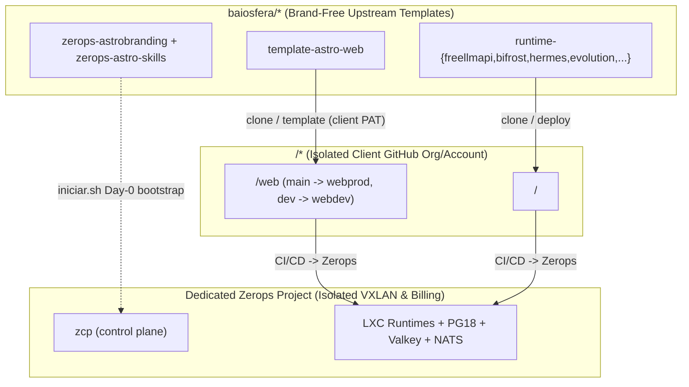

# Zerops AstroBranding — Sovereign Platform Catalog & Control Plane SSoT

> Agnostic Control Plane (`zcp`) orchestrator, Day-0 bootstrapper, governance harness, and modular Zerops recipe catalog for multi-brand Incus LXC deployments.  
> Application code never lives inside this repository: every runtime is decoupled into its own `baiosfera/*` upstream template repository and cloned per client under `<brand>/<app>`.

---

## Day-0 Cold Start on a Fresh `zcp` Container

1. **Bootstrap Control Plane & Sovereign CLIs:**
   ```bash
   curl -fsSL https://raw.githubusercontent.com/baiosfera/zerops-astrobranding/main/iniciar.sh | bash
   ```
   Installs OS prerequisites (`curl`, `git`, `jq`, `fuse3`, `sshfs`, `gettext-base`), clones `zerops-astrobranding` and `zerops-astro-skills` into `/var/www`, symlinks skills into `/var/www/.agents/skills`, symlinks sovereign CLIs into `/var/www/.bin` and `~/.local/bin`, syncs `AGENTS.md`, `.agents/rules/00-SUPREME-DIRECTIVE.md`, and `.agents/hooks.json`, and exposes `/usr/local/bin/zcp-update` (`iniciar.sh --update`).
2. **Optional Full Toolchain, Gentle-AI & Browser Setup:**
   - `./zerops-astrobranding/scripts/setup-gentle.sh` — installs `engram`, `gga`, `gentle-ai`, configures `antigravity`, and binds Engram MCP `cwd` to `/var/www` via `engram-mcp`.
   - `./zerops-astrobranding/scripts/setup-zcp.sh` — configures additional ZCP utilities and mounts adopted Zerops services via SSHFS (`zcp-mount`).
3. **Provision Infrastructure & Runtimes in Zerops:**
   - Selective Lego provisioning via `recipes/steps/*.yaml` or `recipes/services/*.yaml` using `zerops_import`.
   - Full 10-service starter cluster template via `recipes/zerops-import.yml.tpl` (rendered with `envsubst` and `import.yaml`).
4. **Verify Parity Before Coding:**
   ```bash
   ssot-parity-check
   skills-suite-validate -q
   python3 -B /var/www/.bin/hooks/tool-guard.py --test
   ```

---

## Two-Tier Architecture: Control Plane vs. Dedicated LXC Runtimes

1. **Sovereign Control Plane (`zcp`)**:
   - Single-node orchestrator (`minContainers: 1`, `maxContainers: 1`, `cpuMode: SHARED`).
   - Runs Zerops MCP (`zerops_*`), governance hooks (`tool-guard.py`), `ssot-parity-check`, `skills-suite-validate`, `linear-cli`, and SSoT sync tools.
   - Never builds or runs application frameworks (`bun`, `node`, `pytest`) locally on `zcp`.
2. **Dedicated Incus LXC Runtimes**:
   - Each application service runs in its own LXC container and mounts into `zcp` at `/var/www/{hostname}/` via SSHFS.
   - Framework builds and tests run inside each container over SSH (`ssh {hostname} "cd /var/www && <cmd>"`); long-running dev servers run via `zerops_dev_server`.

```text
/var/www/zerops-astrobranding/   # Catalog & Registry ONLY (no app source trees)
├── AGENTS.md                    # Sovereign ZCP & governance rules SSoT
├── .agents/
│   ├── hooks.json               # PreToolUse/PostToolUse/Stop hook contract
│   └── rules/00-SUPREME-DIRECTIVE.md
├── blueprints/
│   ├── prompt-universal-despliegue-zerops.md
│   └── plantilla-universal-web-zerops-v4.md
├── docs/
│   ├── AUDIT_BIFROST_FREELLMAPI.md
│   ├── MANUAL_COCKPIT.md
│   ├── MANUAL_KNOWLEDGE.md
│   ├── MANUAL_MEGA_DOWNLOADER.md
│   ├── MANUAL_TUTOR.md
│   └── MODULARIZATION_GUIDE.md
├── recipes/
│   ├── zerops-import.yml.tpl    # Full modular cluster template
│   ├── services/                # Granular single-service YAML manifests (01..13)
│   └── steps/                   # Surgical deployment step manifests (01..10)
├── scripts/                     # Symlinked CLI tooling (linear-cli, ssot-parity-check, hooks, setup-*)
├── templates/                   # Brand / config starter templates
├── import.yaml                  # Canonical full-stack Zerops import manifest
└── iniciar.sh                   # Day-0 bootstrapper & updater (`zcp-update`)
```

---

## Upstream `baiosfera/*` Template Ecosystem

Upstream templates under `baiosfera/*` are strictly brand-free. Client projects fork/clone into isolated `<brand>/<app>` repositories using their dedicated GitHub token in `/var/www/baiosfera/0ZEROPS-AGY/users-apis/<Brand>/<brand>-keys.md`:

| Repository | Role | Zerops Runtime | Default Port |
|---|---|---|---|
| `baiosfera/zerops-astrobranding` | Catalog, recipes, Day-0 setup & governance CLIs | Control Plane (`zcp`) | — |
| `baiosfera/zerops-astro-skills` | Sovereign Agent Skills library (Dual-RAG) | Synced to `.agents/skills` | — |
| `baiosfera/template-astro-web` | Astro 5 SSR + React 19 + Hono + BullMQ frontend template | `ubuntu/bun@1.4` | `:3000` |
| `baiosfera/runtime-freellmapi` | Multi-provider free LLM proxy (`localstorage` persistence, 429 cooldown) | `ubuntu/nodejs@24` | `:3001` |
| `baiosfera/runtime-bifrost` | Maxim AI Bifrost LLM gateway (PostgreSQL 18 + `chromem`) | `alpine/go@1.22` | `:8080` |
| `baiosfera/runtime-hermes` | Hermes autonomous copilot (NATS + embedded CrewAI) | `ubuntu/python@3.12` | `:8000` |
| `baiosfera/runtime-evolution` | EvolutionGo WhatsApp engine (Go 1.26 source build) | `ubuntu/go@1.22` | `:8085` |
| `baiosfera/runtime-whatsappbot` | Decoupled NATS JetStream + Tool Calling WhatsApp bot worker | `ubuntu/bun@1.4` | `:3005` |
| `baiosfera/runtime-paperclip` | Paperclip AI orchestration & spend-caps control plane | `ubuntu/nodejs@26` | `:3100` |
| `baiosfera/runtime-pidev` | Pi coding agent headless developer runtime | `ubuntu/nodejs@26` | `:3000` |
| `baiosfera/runtime-videoworker` | Ephemeral HTML/Chromium/FFmpeg video rendering worker | `ubuntu/nodejs@22` | `:3000` |

---

## Multi-Project Isolation & Client GitOps



- **Zerops VXLAN Isolation**: Internal service-to-service traffic uses plain `http://{hostname}:{port}` inside each project; separate client projects cannot reach each other over private DNS.
- **GitHub Token Sovereignty**: Upstream commits use `baiosfera`; client repo pushes use the client PAT in `/var/www/baiosfera/0ZEROPS-AGY/users-apis/<Brand>/<brand>-keys.md`. Never commit tokens or client identifiers to `baiosfera/*`.

---

## Critical Architectural Invariants

### 1. EvolutionGo Single-Container Invariant
In `recipes/steps/04-evolution.yaml`, `recipes/services/09-evolution.yaml`, and `import.yaml`, `evolution` MUST remain pinned to `minContainers: 1`, `maxContainers: 1`, with `deploy.temporaryShutdown: true`:
1. WhatsApp Web communicates over one persistent Noise Protocol TCP session.
2. Two concurrent replicas trigger `Stream Error 440: Conflict`, crash loops, and phone number bans.
3. `temporaryShutdown: true` closes the old TCP socket cleanly before the replacement container connects.

### 2. Valkey 7.2 & Bifrost Independence
- Zerops `valkey:single@7.2` does **not** ship RediSearch (`FT.*`).
- `runtime-bifrost` uses **PostgreSQL 18** (`config_store` and `logs_store`) and embedded **`chromem`** (or `qdrant`) for semantic cache — **never** `vector_store.type: "redis"` against Valkey.
- Valkey 7.2 serves BullMQ job queues (`web`, `whatsappbot`) and WhatsApp session/QR state (`evolution`).

### 3. Frugal-First Elastic Autoscaling
Runtime containers default to `cpuMode: SHARED` with `minFreeRamGB: 0.25` (or `0.5` for heavy runtimes) and `minFreeRamPercent: 10`. Internal adapters must bind `HOST: "0.0.0.0"` in runtime environment configuration so Zerops L7 proxies reach every service cleanly.

---

## Remote Runtime Commands (SSH Cheatsheet)

```bash
# Build & test Astro frontend inside its LXC container
ssh web "cd /var/www && bun run build && bun test"

# Run diagnostics inside Bifrost / FreeLLMAPI / Hermes
ssh bifrost "curl -fsS http://127.0.0.1:8080/health"
ssh freellmapi "curl -fsS http://127.0.0.1:3001/api/ping"
ssh hermes "curl -fsS http://127.0.0.1:8000/healthz"

# Inspect PostgreSQL directly from zcp using Zerops-injected env vars
psql "$db_connectionString" -c "\dt"
```

---

## Connected Documentation & Ecosystem

- **Skills SSoT**: [github.com/baiosfera/zerops-astro-skills](https://github.com/baiosfera/zerops-astro-skills)
- **Universal Zerops Prompt Blueprint**: [`blueprints/prompt-universal-despliegue-zerops.md`](blueprints/prompt-universal-despliegue-zerops.md)
- **Modularization Guide**: [`docs/MODULARIZATION_GUIDE.md`](docs/MODULARIZATION_GUIDE.md)
- **Bifrost & FreeLLMAPI Audit**: [`docs/AUDIT_BIFROST_FREELLMAPI.md`](docs/AUDIT_BIFROST_FREELLMAPI.md)
