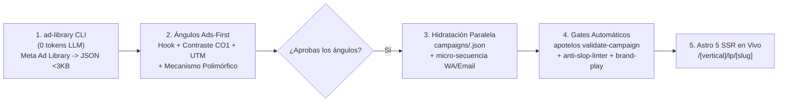

# Manual Práctico de `ad-library` y `ad-campaign-factory` (Fábrica `Ads-First` de Bajo Consumo)

> **Premisa de Mínima Intervención:** Este manual existe para que entiendas cómo funciona el sistema por dentro. **En el día a día no necesitás memorizar comandos ni editar JSONs a mano**: solo decile a tu agente qué competidores o nicho querés analizar y qué campaña querés sacar, y él automatiza toda la cadena.

---

## 1. ¿Qué Problema Resuelve? (Por Qué No Basta Una Landing Estática)

En pauta paga real (`Meta Ads`, `Google`, `TikTok`), una sola landing fija se queda corta cuando querés probar varios ángulos, avatares o temporadas (*rotación de ángulos frescos sobre una misma oferta núcleo*).

Por eso el ecosistema separa:
- **Núcleo Orgánico (`brand-studio`):** páginas fijas `index, follow` diseñadas para posicionarse en Google y asistentes de IA.
- **Fábrica Dinámica `Ads-First` (`ad-campaign-factory`):** genera landings dinámicas bajo **`/[vertical]/lp/[slug]`** (`noindex, follow` por defecto para no ensuciar tu SEO canónico), hidratadas a partir de un **anuncio redactado primero**.

---

## 2. Cómo Funciona la Cadena Paso a Paso

### Paso 1 — Inteligencia de Mercado Sin Quemar Tokens (`ad-library`)
Un scrape crudo de Meta Ad Library pesa ~65 KB llenos de selectores de 200 países y basura HTML. Leer eso directo en el chat desperdicia miles de tokens.
- **`ad-library`** consulta Meta Ad Library (vía API oficial si hay token, Firecrawl o Jina) y **limpia el HTML en Python puro (0 tokens de modelo)**.
- Filtra únicamente anuncios que llevan **14 días o más activos** (los que probablemente son rentables), calcula `days_active`, limpia URLs de destino (`fbclid`) y entrega un resumen ultracompacto de `< 3 KB` (`strategy/ad_library_brief.json`).
- Luego, sobre las 2 o 3 URLs destino ganadoras, el agente lee oferta y objeciones reales usando `meta-research` (`jina:read_url`).

### Paso 2 — Primero el Anuncio, Después la Landing (`phase_2_ad_angles`)
Antes de tocar una sola línea de página, el workflow redacta entre 1 y 5 propuestas de anuncio filtradas obligatoriamente por los Playbooks (`PB00` y `PB02`) y por Oráculo Casa 7 (cuando existe):
- **Filtro Anti-Parroting:** nunca copia listas crudas ni promete "ayudar a todo el mundo"; destila 1 perfil psicológico claro y pasa la **Prueba del Desconocido en 5 Segundos** (disciplina humana primero, nombre propio después).
- **Enfoque al Comprador Ideal:** habla desde la brecha de libertad/margen y criterio, no desde la desesperación.
- **Contraste `CO1`:** ataca un mito o práctica mediocre del mercado sin mencionar competidores por nombre.
- **Elección honesta de Lead Magnet (`lead_magnet_mechanism`):** el workflow **no mete una calculadora a la fuerza**; decide si la campaña convierte mejor con:
  - `none` (directo a video/VSL, evaluación o compra),
  - `freedom_leverage_index` (calculadora de libertad y palanca),
  - `diagnostic_quiz`, `roi_cost_gap`, `resource_guide` o `micro_trial`.
- **Pausa humana opcional:** por defecto se detiene aquí para que elijas o ajustes los ángulos con un simple *"me gustan el 1 y el 3, dale"*.

### Paso 3 — Hidratación Automática 1:1 (`campaigns/<slug>.json`)
Cada ángulo aprobado genera un archivo JSON validado en `workspaces/<linea>/campaigns/<slug>.json` con:
- **Match literal (`Message Match`):** el `H1` y subtítulo de la landing continúan exactamente la promesa del gancho de los primeros 3 segundos del anuncio.
- **Aislamiento SEO automático:** `noindex, follow` por defecto (solo se vuelve `index, follow` si declara un `seo_cluster_id` propio).
- **Etiqueta de mensajería (`camp:<linea>:<slug>`):** WhatsApp y Email saben exactamente desde qué anuncio entró la persona sin mezclarse con otras campañas.

### Paso 4 — Gates Físicos Cero-Errores
Antes de dar por lista la campaña, el workflow corre automáticamente:
1. `apotelos validate-campaign` (esquema Pydantic, UTMs solo externos, reglas de mecanismo y tag).
2. `anti-slop-linter` (revisa **solo los textos visibles al público**, bloqueando tildes faltantes y cualquier jerga interna como *Order Bump*, *BANT*, *DIY/DWY/DFY*, *Rotación Barista* o *Ads-First*).
3. `brand-play sync-copy` (registra los checksums SHA-256 para proteger tus ediciones manuales).

---

## 3. Cómo Pedírselo a Tu Agente (Ejemplos Reales)

No necesitás correr comandos manuales. Solo escribime cosas como:
1. *"Espía Meta Ad Library en Colombia para 'marca personal' y decime qué ángulos llevan más de 20 días activos."*
2. *"Armá 3 ángulos de campaña para `<mi línea>` atacando el problema de horas lineales, uno sin calculadora y dos con índice de libertad."*
3. *"Creá una nueva campaña temporal de cierre de año para `<mi línea>` conectada al mismo checkout."*

---

## 4. Referencia Técnica (Solo por si Querés Inspeccionar)

- **CLI `ad-library`:**
  - `ad-library fetch --query "marca personal" --country CO --min-days 14 --out strategy/ad_library_brief.json`
  - `ad-library parse --input-file raw.md --min-days 14 --out strategy/ad_library_brief.json`
  - `ad-library diff --prev ayer.json --curr hoy.json`
- **Validador de campañas:** `apotelos validate-campaign /mnt/localstorage/<Proyecto>/dev/workspaces/<linea>/campaigns/`
- **Workflow portable:** `/var/www/zerops-astrobranding/workflows/ad-campaign-factory/ad_campaign_factory.wf`
- **Ruta SSR universal (`template-astro-web`):** `src/pages/[vertical]/lp/[slug].astro` + componente opcional `src/components/InteractiveProofCalculator.astro`.
