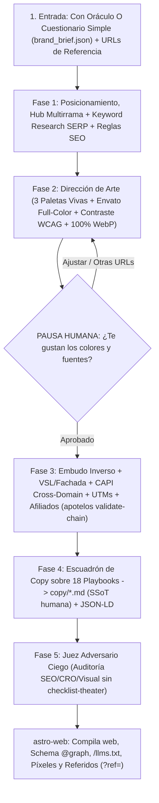

# Manual Práctico de `brand-studio` 360° (Con o Sin Oráculo · Playbooks Obligatorios · Smart-VSL · Cross-Domain CAPI · Afiliados)

> **Audiencia:** Fundadores, estrategas y operadores en cualquier proyecto Zerops (`zcp`). Escrito en lenguaje directo y práctico, sin asumir conocimientos de programación.

---

## 1. Visión General del Sistema (Arquitectura 360°)



### ¿Por qué corre directo aquí (`brand-studio`) y no en Hermes / CrewAI?
Las pruebas reales mostraron que `hermes` tiene solo 512 MB de RAM y depende de modelos gratuitos en `freellmapi`/`bifrost` propensos a timeouts y caídas. Por eso:
- **`brand-studio` (Nativo en Antigravity `run_workflow`)** se encarga de toda la **creación de marca, investigación SERP, dirección de arte, estrategia de embudo y copywriting** usando modelos de frontera y herramientas reales de búsqueda web. Funciona idéntico en cualquier `zcp` nuevo tras ejecutar `iniciar.sh`.
- **`hermes` + `crewai` + `pydanticai`** quedan únicamente para tareas operativas automáticas 24/7 *después* de lanzar (alertas por Telegram, reportes diarios de pauta o clasificación rápida de leads), cuando `bifrost` esté operativo.

---

## 2. Cómo Arrancar una Marca (Con Oráculo o Sin Oráculo)

El sistema acepta **dos caminos de entrada** y ambos producen la misma estructura limpia en `/mnt/localstorage/<Proyecto>/dev/workspaces/<linea>/`:

1. **Camino A — Con Oráculo:** ya tienes `astrobranding_<marca>.md` y `client_dumps_15_shards.json`. Oráculo aporta el enfoque psicológico, narrativo y diferenciador del fundador, **pero ya NO impone colores lavados ni tipografías por fórmula matemática**.
2. **Camino B — Sin Oráculo (cliente tradicional):** creas un archivo simple `brand_brief.json` con:
   - Tu rol principal (por ejemplo: *Estratega Digital*, *Mentor de Marcas*).
   - Términos o siglas propias que **sí quieres enseñar al público** (`public_brand_concepts`, por ejemplo `OPB`, `CO1`).
   - Qué vendes, a quién y tus precios base.
   - Entre **2 y 5 URLs de páginas de referencia** (solo para entender tensión de color, ritmo visual o mecánica de embudo, nunca para copiarles).

> **Fuente Única de Verdad (`ecosystem.json`):** Todo proyecto guarda su mapa global exclusivamente en `/mnt/localstorage/<Proyecto>/dev/ecosystem.json`. Nunca se crean copias paralelas en `_shared/`.

### Cortafuegos de lenguaje: Interno vs. Público
En conversaciones internas entre fundador y agente usamos conceptos operativos como *verticales*, *DIY*, *DWY*, *DFY*, *BANT*, *PWYW* u *Order Bump*. **Ninguno de esos términos técnicos debe filtrarse al texto público que lee el cliente final** (salvo siglas estratégicas autorizadas expresamente en `public_brand_concepts`). El verificador `anti-slop-linter` bloquea cualquier fuga antes de compilar la web.

---

## 3. Cómo Trabajar la Fase Visual (Colores Reales y Fuentes de Envato)

### Paletas con carácter real (`chroma_engine v5.0`)
- Puedes pasar colores curados (`--palette-json`) o un color principal exacto (`--seed-hex "#F50023"`). El motor **conserva intacto tu color** (sin apagarlo a tonos pastel) y calcula automáticamente si el texto encima del botón debe ser negro puro (`#0a0a0a`) o blanco (`#ffffff`) para cumplir WCAG (`>= 4.5:1`).

### Previsualización de fuentes Envato a color real (`envato_font_preview v4.0`)
- La galería HTML (`brand/previews/preview_gallery.html`) renderiza **4 tarjetas reales** para cada fuente:
  1. Nombre de tu marca en **Color Primario** sobre el fondo.
  2. Nombre de tu marca en **Color Acento** sobre superficie secundaria.
  3. **Tarjeta Invertida de Marca** (fondo en color primario y marca encima con contraste real).
  4. **Mini Hero + Botón CTA Real** con la fuente de lectura de Google Fonts debajo.
- **Cómo probar fuentes que TÚ encontraste en Envato Elements:**
  Copia las URLs exactas de Envato y ejecuta:
  ```bash
  envato-font-preview \
    --envato-urls "https://elements.envato.com/fonts/...,https://app.envato.com/fonts/..." \
    --chroma /mnt/localstorage/<Proyecto>/dev/workspaces/<linea>/brand/chroma_manifest.json \
    --texts "TU MARCA,TU SLOGAN" \
    --out /mnt/localstorage/<Proyecto>/dev/workspaces/<linea>/brand/previews
  ```
- La Fase 2 se **detiene obligatoriamente** hasta que des tu visto bueno visual. Solo después se redacta el copy final.

---

## 4. Tu Copy es Tuyo: Cómo Editar `copy/*.md` sin Perder Cambios

Dentro de `workspaces/<linea>/`:
- **`copy/*.md` es tu archivo editable maestro (SSoT):** puedes cambiar frases, historias, objeciones o precios directamente en los `.md`.
- **`web/copy_strings.es.json` NO es para editar a mano:** es un diccionario estructurado para que Astro 5 cargue rápido los textos de botones, calculadoras y FAQs sin errores.
- Cuando edites cualquier `.md`, pídele al agente (o corre en consola):
  ```bash
  brand-play sync-copy --workspace /mnt/localstorage/<Proyecto>/dev/workspaces/<linea> --check
  ```
  Si detecta que editaste algo (`NEEDS_RECONCILIATION`), el agente actualiza `web/copy_strings.es.json` antes de compilar la web, garantizando que **tus cambios humanos nunca se pierdan ni queden pisados**.

---

## 5. Guía Sencilla de UTMs, Píxeles, CAPI Cross-Domain y Concatenación

### ¿Qué es un UTM y para qué sirve?
Un **UTM** es una etiqueta invisible al final de un enlace que le dice a tu web y a tus reportes **qué campaña, qué plataforma y qué anuncio o video exacto trajo a ese cliente**. El visitante ve exactamente la misma página, pero tú puedes medir qué creativo produce citas y ventas reales (y cuáles solo traen clics vacíos).

Sus 5 partes (plus parámetros opcionales de conjunto/anuncio `utm_adset`, `utm_ad`):
1. `utm_source`: de qué plataforma viene (`meta`, `google`, `instagram`, `youtube`, `linkedin`, `whatsapp`, `email`).
2. `utm_medium`: cómo llegó (`paid_social`, `cpc`, `organic`, `email`).
3. `utm_campaign`: nombre de la campaña (ej. `captacion_consultores_co`).
4. `utm_content`: identifica el video, imagen o ángulo exacto (ej. `video_nomina_3m_v1` vs `carrusel_ia_v2`).
5. `utm_term`: la palabra buscada en Google Ads (ej. `mentor_de_marcas`).

### Regla de Oro: Dónde SÍ van y dónde NUNCA van
- **SÍ VAN** en todo enlace **EXTERNO** que apunta hacia tu web: anuncios de Meta/Google/TikTok/LinkedIn, link de bio, YouTube, correos y mensajes de WhatsApp.
- **NUNCA VAN** en enlaces **INTERNOS** dentro de tu propia web, porque poner un UTM interno **sobrescribe y borra el anuncio original que trajo al cliente**.

### Puente CAPI entre Dominios (`cross_domain_bridge`) y Escape de IG/FB
Cuando el cliente hace clic para ir a un **subdominio o dominio externo de pago/app** (por ejemplo `tudominio.com` $\to$ `pagar.tudominio.com` o `otraweb.com`):
- El navegador por sí solo pierde cookies de terceros entre dominios distintos. Por eso `brand-studio` modela el **`cross_domain_bridge`**: decora el botón saliente con `fbp`, `fbc`, `src` UUID, `event_source_url`, UTMs y `ref_code` de afiliado (o los envía juntos en el JSON hacia el checkout con validación previa de correo).
- En botones que abren **Google Pay / Apple Pay desde Instagram o Facebook**, incluye un escape guiado (*"Abrir en Chrome"*) con respaldo a los 6 segundos si el navegador interno bloquea la billetera.

---

## 6. Hub Multimarca, Arquetipos de Oferta, Video, Afiliados (`?ref=`) y Puertas SEO

### 6.1 Hub General con Subrutas y Guía Flotante
Cuando un fundador agrupa varias líneas bajo un dominio paraguas (`/` $\to$ subrutas `/academia`, `/mentoria`, `/agencia` que luego migran a dominios propios):
- `hub_branches` declara cada ruta, nivel de acompañamiento y dominio futuro sin canibalizar palabras clave.
- Opcionalmente, un widget orientador flotante (*"¿Te ayudo a elegir?"*) guía al visitante según su etapa hacia la línea exacta sin saturar la portada.

### 6.2 Arquetipos Holísticos de Oferta y Garantía (`offer_archetype`)
`brand-studio` adapta automáticamente estructura y prueba social según la naturaleza real del producto o servicio:
- **Evaluación High-Ticket / Mentoría 1:1:** barra de autoridad, reencuadre cognitivo del problema, progresión por etapas, inversión pre-encuadrada antes del calendario y **Garantía condicional de extensión** (*si cumples las prácticas acordadas sin avance medible, extendemos el acompañamiento*).
- **Plataforma / Membresía / Academia con Planes:** narrativa de dolor día a día (*Lunes a Viernes*), **3 planes con paridad del 100 % de acceso** donde el plan intermedio destaca en ahorro (*Paga 2, lleva 3*), **prueba de `$0 hoy`** por 5–7 días y capturas reales sin maquillar.
- **Producto o Kit Transformacional:** **3 objeciones principales resueltas arriba del todo**, definición etimológica/filosófica del mecanismo, **Stack de Valor 10× con ancla en moneda local** y cierre empático sin culpa.
- **Servicio Llave en Mano / Agencia:** **Smart-VSL híbrido de 4 minutos**, simulador interactivo de 3 pestañas (*Datos de ejemplo*), contraste financiero en 3 cajas (`Hoy -> Con sistema -> Anual`) y formulario en 3 pasos (Paso 1 solo botones).

### 6.3 Smart-VSL de 4 Minutos vs. Fachada Lazy de Video (`lazy_facade_video`)
- **`hybrid_smart_vsl`:** video que arranca en silencio con cartel A/B invitando a activar el sonido, barra de progreso rápida (`1 - (1 - t)^2.2`), aviso suave *"¿Ya viste el video?"* si pulsan Aplicar antes de 60s y evento `VslWatched90s` tras 90 segundos con sonido.
- **`lazy_facade_video`:** cuando prima la velocidad extrema en móvil, muestra una portada WebP nítida (`Ver video · M:SS`) que **no descarga ni carga el reproductor hasta que el usuario hace clic**.

### 6.4 Programa Soberano de Referidos y Afiliados (`?ref=socio`)
`brand-studio` integra el Módulo 6 de `16_personal_branding_authority_and_communities.md`:
- Los enlaces de afiliados usan `?ref=<codigo_socio>` junto a los UTMs en la misma cookie de 90 días (y en el payload de checkout junto a `ref_code`), **sin borrar la atribución del anuncio** y bloqueando autocompras (`self_referral_blocked: true`).
- `apotelos validate-chain` exige escalones de comisión claros, ventana `>= 30–90 días`, retención preventiva de pago (30 días) y pisos rentables (`EPC >= $1.00 USD` y `EPL >= $2.00 USD`).

### 6.5 Gates Automáticos contra Anti-Patrones Técnicos
Al auditar URLs externas reales es común hallar errores graves que `brand-studio` bloquea desde la raíz: cero `noindex` accidental en landings de adquisición, idioma `<html lang>` coherente, jerarquía real `H1 > H2 > body`, **`JSON-LD @graph` no vacío**, imágenes **`100 % WebP/AVIF`** y contraste WCAG `>= 4.5:1` en botones.

---

## 7. Cómo Usarlo en Cualquier ZCP Nuevo

En cualquier proyecto o servidor ZCP recién creado:
1. Ejecuta `iniciar.sh --update` (instala todas las skills, Playbooks `00..17`, `orchesbrand`, `apotelos`, `brand-play`, `brand_studio.wf` y este manual en `/var/www/artifacts/blueprints/`).
2. Verifica que el sistema está sano con `ssot-parity-check --with-tests` y `skills-suite-validate --strict-budget --with-tests`.
3. Pídele al agente activar `brand-studio` indicando proyecto, rama/línea, país y (opcional) tus URLs de referencia, arquetipo de oferta, ramas del Hub y enlaces de Envato.
