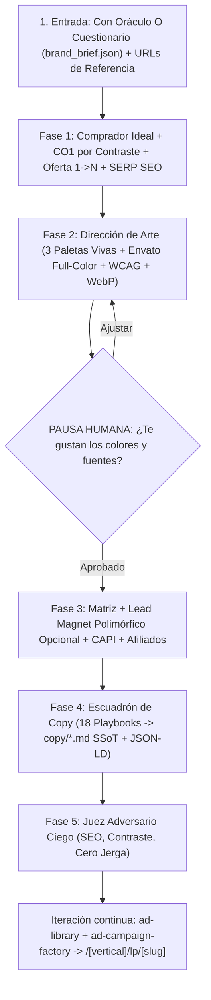

# Manual Práctico de `brand-studio` 360° (v2.0 — Núcleo SEO/AEO/GEO + Capa Ads-First + Lead Magnet Polimórfico)

> **Audiencia:** Fundadores, estrategas y operadores en cualquier proyecto Zerops (`zcp`). Escrito en lenguaje directo y práctico, bajo la premisa de **mínima intervención tuya**: vos das la intención en lenguaje natural y el agente automatiza todo lo técnico.

---

## 1. Visión General del Sistema (Arquitectura Dual de Dos Capas)

En lugar de construir sitios estáticos rígidos, `brand-studio` v2.0 separa el sitio en **dos capas complementarias sobre el mismo motor Astro 5 SSR (`template-astro-web`)**:

| Capa | Qué hace | Indexación y Frecuencia | Cómo se opera |
|---|---|---|---|
| **1. Núcleo Orgánico (`SEO/AEO/GEO`)** | Captura demanda activa en Google y asistentes de IA (ChatGPT, Perplexity, Claude) con autoridad evergreen, esquema `@graph` y `/llms.txt`. | `index, follow` · 1 intención = 1 URL fija. Se diseña **1 vez** por marca/línea con `brand-studio`. | `brand_studio.wf` (5 fases, con pausa visual humana). |
| **2. Motor Dinámico `Ads-First` (`/[vertical]/lp/[slug]`)** | Genera tantas landings como anuncios, ángulos, avatares o temporadas necesites, con **100 % de *message match*** entre gancho del anuncio $\to$ titular $\to$ prueba $\to$ secuencia WhatsApp/Email. | `noindex, follow` por defecto (salvo clúster SEO propio). Se itera rápido con `ad-campaign-factory`. | `ad-library` + `ad_campaign_factory.wf` (ver [`MANUAL_AD_CAMPAIGN_FACTORY.md`](file:///var/www/zerops-astrobranding/blueprints/MANUAL_AD_CAMPAIGN_FACTORY.md)). |

---

## 2. Pilares Estratégicos de `brand-studio` v2.0

1. **Comprador Ideal (no solo "dolor por escasez"):** hablamos a la brecha entre la **capacidad real de la persona** y su **nivel actual de libertad y margen** (por ejemplo, `Libertad = Beneficios / Horas trabajadas`), destilando 1 arquetipo nítido a partir de `PB02` y —cuando existe Oráculo— la **Casa 7 (Descendente)**, **Casa 8/11** y **Venus**, en lugar de repetir listas de "le ayudo a todo el mundo".
2. **Filtro Anti-Complacencia y Prueba del Desconocido en 5s (`PB00`):** tus notas de briefing son materia prima, nunca copy literal. Todo nombre propio o metodología inventada se ancla primero en la disciplina real que un desconocido ya entiende antes de nombrar el método.
3. **Protocolo Operativo vs. Línea Comercial (`entity_role`):** lo que aplicas internamente en tu trabajo (`operating_protocol`) se explica con transparencia como respaldo, pero **no** se mezcla dentro del selector comercial de productos en venta (`commercial_offer`).
4. **Category of One (`CO1`) por contraste polarizante:** *"las ideas atraen; las ofertas filtran"*. Tu marca no compite comparando precios: fija un criterio irrepetible y demuestra su método en vivo.
5. **Oferta `1 → N` por anillos de cercanía/velocidad:** un solo núcleo de valor con distintos niveles de acompañamiento o acceso (`entrada` $\to$ `programa base` $\to$ `círculo cercano` $\to$ `llave en mano`), sin multiplicar productos desconectados.
6. **Mecanismo de Captación Polimórfico y Opcional (`lead_magnet_mechanism`):** **NO todas las landings ni todos los clientes llevan calculadora.** Cada línea o campaña elige libremente:
   - `none` — directo a video, carta de ventas, evaluación o checkout (sin calculadora).
   - `freedom_leverage_index` — índice `Libertad = Beneficios / Horas` y escenario de palanca `1 → N`.
   - `diagnostic_quiz` — diagnóstico interactivo sin registro con tarjeta compartible.
   - `roi_cost_gap` — comparador financiero/ROI para empresas B2B o SaaS.
   - `commission_simulator` — simulador para socios/afiliados (`/afiliados`).
   - `resource_guide` / `micro_trial` — guía práctica o micro-prueba `$0`/`$1`.

---

## 3. `brand-studio` vs. `brand-play`: Qué Hace Cada Uno

- **`brand-studio` (el Estudio Creativo):** investiga el mercado, diseña paletas y fuentes, arma la matriz de embudo y redacta el copy leyendo los 18 Playbooks completos. **Reemplazó** al viejo modo de rellenar plantillas rígidas (`brand-play transmute`, hoy deprecado).
- **`brand-play` (el Guardián de SSoT Humano):** es el verificador técnico que compara por SHA-256 tus ediciones manuales en `copy/*.md` y `campaigns/*.json` contra `web/copy_strings.es.json` y corre `anti-slop-linter` antes de compilar la web, para que **ningún build pise lo que vos editaste**.

---

## 4. Cómo Arrancar o Usar el Modo Piloto Automático

No necesitás saber los flags ni nombres de scripts. Solo dile al agente en lenguaje natural:
- *"Arranca la identidad y núcleo orgánico de `<Marca>` en `<país>`"* $\to$ el agente detecta `ecosystem.json`, ejecuta `brand_studio.wf` hasta Fase 2 y solo te frena para aprobar colores y fuentes.
- *"Espía Meta Ad Library para `<tema>` y armá 3 anuncios con sus landings para `<línea>`"* $\to$ el agente corre `ad-library` (sin gastar tokens de chat en HTML sucio) + `ad_campaign_factory.wf`, valida con `apotelos` y `anti-slop-linter`, y solo te pide el visto bueno de los ángulos.

### Cortafuegos Terminológico (Interno vs. Público)
Internamente usamos términos operativos (`verticales`, `DIY`, `DWY`, `DFY`, `BANT`, `PWYW`, `Order Bump`, `Rotación Barista`, `Ads-First`, `Comprador Ideal`). **Ninguno se filtra al texto público**: `anti-slop-linter` bloquea cualquier fuga y cualquier palabra en español sin tilde o `ñ` antes de compilar.

---

## 5. Tu Copy es Tuyo (`copy/*.md` + `campaigns/*.json`)

- **`copy/*.md` y `campaigns/*.json` son tus archivos maestros editables (SSoT).**
- **`web/copy_strings.es.json` es un diccionario derivado** para Astro 5 SSR.
- Cuando edites cualquier texto, el agente corre `brand-play sync-copy --workspace <ws> --check` para reconciliar tus cambios humanos sin perder ni una coma.

---

## 6. Telemetría Pura, CAPI Cross-Domain y Entrelazado Secuencial

- **`ViewContent` exclusivo de captación:** se dispara en landings orgánicas y en `/[vertical]/lp/[slug]`, **nunca** en `/checkout`, `/app`, `/admin` o `/gracias`.
- **UTMs solo externos:** nunca en enlaces internos; se preservan hasta el checkout junto a `?ref=<socio>` (`cross_domain_bridge` + escape de navegador interno Instagram/Facebook a 6s).
- **Entrelazado secuencial sin distracciones (`cross_funnel_bridges`):** otras líneas aparecen solo tras el FAQ (`bottom_section`), en la página de gracias, en *downsell* o en Email/WhatsApp desde el Día 8+ (máximo 1 secuencia puente activa y 24h de supresión entre WhatsApp y correo).

---

## 7. Referencia Rápida para Operadores (Automática en cada ZCP)

1. `zcp-update` (o `iniciar.sh --update`) instala `ad-library`, `apotelos`, `brand-play`, `anti-slop-linter`, ambos workflows (`brand-studio` y `ad-campaign-factory`) y este manual.
2. Verificación física global: `ssot-parity-check --with-tests` y `skills-suite-validate --strict-budget --with-tests`.
