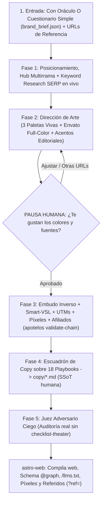

# Manual Práctico de `brand-studio` 360° (Con o Sin Oráculo · Playbooks Obligatorios · Smart-VSL · UTMs · Afiliados)

> **Audiencia:** Fundadores, estrategas y operadores en cualquier proyecto Zerops (`zcp`). Escrito en lenguaje directo y práctico, sin asumir conocimientos de programación.

---

## 1. Visión General del Sistema (Arquitectura 360°)



### ¿Por qué corre directo aquí (`brand-studio`) y no en Hermes / CrewAI?
Las pruebas reales mostraron que `hermes` tiene solo 512 MB de RAM y depende de modelos gratuitos en `freellmapi`/`bifrost` propensos a timeouts y caídas. Por eso:
- **`brand-studio` (Nativo en Antigravity `run_workflow`)** se encarga de toda la **creación de marca, investigación SERP, dirección de arte, estrategia de embudo y copywriting** usando modelos de frontera y herramientas reales de búsqueda web. Funciona idéntico en cualquier `zcp` nuevo tras ejecutar `iniciar.sh`.
- **`hermes` + `crewai` + `pydanticai`** quedan únicamente para tareas operativas automáticas 24/7 *después* de lanzar (alertas por Telegram, reportes diarios de pauta o clasificación rápida de leads), cuando `bifrost` esté operativo.

---

## 2. Cómo Arrancar una Marca (Con Oráculo o Sin Oráculo)

El sistema acepta **dos caminos de entrada** y ambos producen la misma estructura limpia en `/mnt/localstorage/<Proyecto>/dev/workspaces/<linea>/`:

1. **Camino A — Con Oráculo:** ya tienes `astrobranding_<marca>.md` y `client_dumps_15_shards.json`. Oráculo aporta el enfoque psicológico, narrativo y diferenciador del fundador, **pero ya NO impone colores lavados ni tipografías por fórmula matemática**.
2. **Camino B — Sin Oráculo (cliente tradicional):** creas un archivo simple `brand_brief.json` con:
   - Tu rol principal (por ejemplo: *Estratega Digital*, *Mentor de Marcas*).
   - Términos o siglas propias que **sí quieres enseñar al público** (`public_brand_concepts`, por ejemplo `OPB`, `CO1`).
   - Qué vendes, a quién y tus precios base.
   - Entre **2 y 4 URLs de páginas de referencia** (solo para entender tensión de color, ritmo visual o mecánica de embudo, nunca para copiarles).

### Cortafuegos de lenguaje: Interno vs. Público
En conversaciones internas entre fundador y agente usamos conceptos operativos como *verticales*, *DIY*, *DWY*, *DFY*, *BANT*, *PWYW* u *Order Bump*. **Ninguno de esos términos técnicos debe filtrarse al texto público que lee el cliente final** (salvo siglas estratégicas autorizadas expresamente en `public_brand_concepts`). El verificador `anti-slop-linter` bloquea cualquier fuga antes de compilar la web.

---

## 3. Cómo Trabajar la Fase Visual (Colores Reales y Fuentes de Envato)

### Paletas con carácter real (`chroma_engine v5.0`)
- Puedes pasar colores curados (`--palette-json`) o un color principal exacto (`--seed-hex "#F50023"`). El motor **conserva intacto tu color** (sin apagarlo a tonos pastel) y calcula automáticamente si el texto encima del botón debe ser negro puro (`#0a0a0a`) o blanco (`#ffffff`) para máxima legibilidad y contraste.

### Previsualización de fuentes Envato a color real (`envato_font_preview v4.0`)
- Ya no ves solo letras negras o blancas aburridas. La galería HTML (`brand/previews/preview_gallery.html`) renderiza **4 tarjetas reales** para cada fuente:
  1. Nombre de tu marca en **Color Primario** sobre el fondo.
  2. Nombre de tu marca en **Color Acento** sobre superficie secundaria.
  3. **Tarjeta Invertida de Marca** (fondo en color primario y marca encima con contraste real).
  4. **Mini Hero + Botón CTA Real** con la fuente de lectura de Google Fonts debajo.
- **Cómo probar fuentes que TÚ encontraste en Envato Elements:**
  Copia las URLs exactas de Envato y ejecuta:
  ```bash
  envato-font-preview \
    --envato-urls "https://elements.envato.com/fonts/...,https://app.envato.com/fonts/..." \
    --chroma /mnt/localstorage/<Proyecto>/dev/workspaces/<linea>/brand/chroma_manifest.json \
    --texts "TU MARCA,TU SLOGAN" \
    --out /mnt/localstorage/<Proyecto>/dev/workspaces/<linea>/brand/previews
  ```
- La Fase 2 se **detiene obligatoriamente** hasta que des tu visto bueno visual. Solo después se redacta el copy final.

---

## 4. Tu Copy es Tuyo: Cómo Editar `copy/*.md` sin Perder Cambios

Dentro de `workspaces/<linea>/`:
- **`copy/*.md` es tu archivo editable maestro (SSoT):** puedes cambiar frases, historias, objeciones o precios directamente en los `.md`.
- **`web/copy_strings.es.json` NO es para editar a mano:** es un diccionario estructurado para que Astro 5 cargue rápido los textos de botones, calculadoras y FAQs sin errores.
- Cuando edites cualquier `.md`, pídele al agente (o corre en consola):
  ```bash
  brand-play sync-copy --workspace /mnt/localstorage/<Proyecto>/dev/workspaces/<linea> --check
  ```
  Si detecta que editaste algo (`NEEDS_RECONCILIATION`), el agente actualiza `web/copy_strings.es.json` antes de compilar la web, garantizando que **tus cambios humanos nunca se pierdan ni queden pisados**.

---

## 5. Guía Sencilla de UTMs, Píxeles y Concatenación Total

### ¿Qué es un UTM y para qué sirve?
Un **UTM** es una etiqueta invisible al final de un enlace que le dice a tu web y a tus reportes **qué campaña, qué plataforma y qué anuncio o video exacto trajo a ese cliente**. El visitante ve exactamente la misma página, pero tú puedes medir qué creativo produce citas y ventas reales (y cuáles solo traen clics vacíos).

Sus 5 partes:
1. `utm_source`: de qué plataforma viene (`meta`, `google`, `instagram`, `youtube`, `linkedin`, `whatsapp`, `email`).
2. `utm_medium`: cómo llegó (`paid_social` si es pauta en redes, `cpc` si es búsqueda en Google, `organic` si es contenido gratis, `email`).
3. `utm_campaign`: nombre de la campaña (ej. `captacion_consultores_co`).
4. `utm_content`: **la más importante para vender** — identifica el video, imagen o ángulo exacto (ej. `video_nomina_3m_v1` vs `carrusel_ia_v2`).
5. `utm_term`: la palabra buscada en Google Ads (ej. `mentor_de_marcas`).

### Regla de Oro: Dónde SÍ van y dónde NUNCA van
- **SÍ VAN** en todo enlace **EXTERNO** que apunta hacia tu web: anuncios de Meta/Google/TikTok/LinkedIn, link de bio en Instagram/LinkedIn, descripciones de YouTube, botones de correos y enlaces enviados por WhatsApp.
- **NUNCA VAN** en enlaces **INTERNOS** dentro de tu propia web (ej. botones que llevan del inicio `/` hacia `/ready-now` o `/checkout`), porque poner un UTM interno **sobrescribe y borra el anuncio original que te trajo al cliente**.

### Cómo se concatena todo en `brand-studio` (Fase 3)
Cada pieza se valida con `apotelos validate-chain strategy/concatenation_matrix.json` antes de construir la web:
1. **Intención / Palabra Clave (`1 intención = 1 URL`)** → página exacta con `/llms.txt` y `Schema.org @graph` para Google y motores de IA.
2. **Anuncio + UTM externo** → la persona entra y la web guarda su origen en una cookie propia de 90 días (`__attr_session`) junto al ID del clic (`fbclid`, `gclid`, `wbraid`, `gbraid`).
3. **Copy + Oferta + Filtro** → si la persona califica, el servidor dispara el evento `Lead` por Browser Pixel + CAPI con el mismo `event_id` (sin duplicar, y usando variables aisladas por dominio, ej. `DOMINIO1_META_PIXEL_ID` vs `DOMINIO2_META_PIXEL_ID`).
4. **Remarketing + Mensajería** → quienes no completan el siguiente paso entran a audiencias específicas de remarketing y secuencias congruentes de correo y WhatsApp.

---

## 6. Hub Multimarca, Smart-VSL de 4 Minutos, Demos Interactivas y Afiliados (`?ref=`)

### Hub General con Subrutas y Puentes a Dominios Futuros
Cuando un fundador agrupa varias líneas bajo un dominio paraguas (por ejemplo `/` como puerta de entrada hacia subrutas especializadas `/academia`, `/mentoria`, `/agencia` que luego migran a dominios independientes):
- `hub_branches` declara cada ruta, su nivel de acompañamiento y su dominio futuro sin duplicar contenido ni canibalizar palabras clave en Google.
- La página principal orienta al visitante según su momento real (aprender por su cuenta, acompañamiento guiado o implementación llave en mano) con lenguaje humano, nunca con siglas operativas internas.

### Smart-VSL de 4 Minutos + Simulador Interactivo + Formulario de 3 Pasos
Para ofertas de ticket medio/alto y servicios B2B/B2C de automatización:
- **Smart-VSL Híbrido:** Video corto (~4 min) que arranca en silencio para no espantar en móvil, invita con un botón grande a activar el sonido desde el segundo 0, usa una barra de progreso visual rápida al inicio para retener atención y dispara un evento propio de retargeting tras **90 segundos con sonido** (`VslWatched90s`) para crear audiencias de altísima intención.
- **Compuerta Suave al Aplicar:** Si alguien pulsa *Aplicar* sin haber visto 60 segundos del video, aparece un aviso amable ofreciendo verlo primero o continuar al formulario sin bloquear la venta.
- **Simulador de 3 Pestañas + Contraste Financiero en 3 Cajas:** En lugar de prometer en abstracto, muestra 3 casos reales interactivos de cómo trabaja el sistema (etiquetados claramente como datos de ejemplo) junto al comparativo financiero concreto (`Hoy -> Con sistema -> Ganancia adicional al año`).
- **Formulario en 3 Micro-Pasos (~30s):** El Paso 1 solo pide tocar 1 opción (cero escritura) para bajar la fricción inicial; los datos de contacto se piden en los Pasos 2 y 3.

### Programa Soberano de Referidos y Afiliados (`?ref=socio`)
`brand-studio` integra las reglas del Módulo 6 de `16_personal_branding_authority_and_communities.md`:
- Los enlaces de afiliados usan `?ref=<codigo_socio>` en paralelo a los UTMs dentro de la misma cookie de 90 días, **sin borrar la atribución del canal** y bloqueando autocompras (`self_referral_blocked: true`).
- `apotelos validate-chain` verifica antes de lanzar que existan escalones de comisión claros, ventana mínima de 30–90 días, retención preventiva de pago (30 días para cubrir garantías) y pisos mínimos rentables (`EPC >= $1.00 USD` y `EPL >= $2.00 USD`).

---

## 7. Cómo Usarlo en Cualquier ZCP Nuevo

En cualquier proyecto o servidor ZCP recién creado:
1. Ejecuta `iniciar.sh --update` (instala todas las skills, Playbooks `00..17`, `orchesbrand`, `apotelos`, `brand-play`, `brand_studio.wf` y este manual en `/var/www/artifacts/blueprints/`).
2. Verifica que el sistema está sano con `ssot-parity-check --with-tests` y `skills-suite-validate --strict-budget --with-tests`.
3. Pídele al agente activar `brand-studio` indicando proyecto, rama/línea, país y (opcional) tus URLs de referencia, ramas del Hub y enlaces de Envato.
