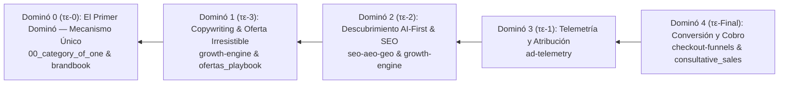

# Manual Maestro Canónico: Protocolo Apoτέlοs v1.0
## Arqueología del Futuro, Arquitectura de Reversa Causal & Malla Agéntica Soberana en Zerops

---

## 1. Fundamentos Filosóficos y Ontológicos

El **Protocolo Apoτέlοs** (del griego *από το τέλος*, "desde el final") nace de un principio rector de la ingeniería de conversión y soberanía de software:

> **"No vamos hacia el futuro; venimos de él."**

En el desarrollo tradicional de software y marketing, los equipos operan en orden cronológico directo:
$$\text{Idea} \longrightarrow \text{Branding} \longrightarrow \text{Código} \longrightarrow \text{Tráfico} \longrightarrow \text{Conversión}$$

Este enfoque convencional produce tres patologías fatales:
1. **Desalineación Semántica**: El copy habla de una cosa, el SEO indexa otra y la telemetría mide eventos desconectados.
2. **Slop Genérico**: Agentes LLM generan código y textos abstractos porque no tienen anclado el resultado de conversión final.
3. **Ceguera de Atribución**: Los píxeles y conversiones API (CAPI) se agregan como un "parche tardío", perdiendo atribución de primera parte.

**Apotelos invierte la flecha causal**: El resultado final ($\tau\epsilon$-Final) se trata como un **hecho histórico inmutable** que ya ocurrió, y el sistema se reconstruye hacia atrás hasta llegar al Primer Dominó ($\tau\epsilon$-0).

---

## 2. Los 5 Dominós Causales (De $\tau\epsilon$-Final a $\tau\epsilon$-0)



### Dominó 4 ($\tau\epsilon$-Final): Conversión, Checkout y Cobro
- **Propósito**: Definir la transacción económica consumada.
- **Invariantes**: Modelo de cobro (carrito e-commerce, pasarela Bancolombia/Wompi, pago contra entrega COD con OTP, agendamiento de cita en calendario, o pago de suscripción recurrente).
- **Contrato de Salida**: `conversion_goal`, montos, pasarelas activas y webhooks de confirmación.

### Dominó 3 ($\tau\epsilon$-1): Telemetría y Atribución (Ads-First)
- **Propósito**: Asegurar la infraestructura de medición antes de redactar una sola línea de copy o crear landings.
- **Invariantes**: Meta CAPI (Server-to-Server) con validación de hash SHA-256, Google Ads Enhanced Conversions, TikTok Events API, Consent Mode v2 (default `denied`), cookies 1st-party (`__attr_session`) a 90 días con protección ITP.
- **Contrato de Salida**: `telemetry_spec` con el mapeo exacto de eventos (`Purchase`, `InitiateCheckout`, `Lead`, `Schedule`).

### Dominó 2 ($\tau\epsilon$-2): Descubrimiento AI-First & SEO Semántico
- **Propósito**: Posicionar la marca ante modelos de lenguaje y motores de búsqueda antes de atraer tráfico humano.
- **Invariantes**: Endpoint `/llms.txt` con síntesis de la categoría, Schema.org `@graph` validado con tipado estricto (`Product` y `Offer` para e-commerce; `LocalBusiness` / `MedicalBusiness` para servicios/estética), metadatos IPTC en imágenes.
- **Contrato de Salida**: `seo_aeo_spec` con entidades canónicas y grafo de conocimiento.

### Dominó 1 ($\tau\epsilon$-3): Copywriting Neuro-persuasivo & Oferta Irresistible
- **Propósito**: Crear mensajes que atacan el dolor raíz del avatar utilizando exactamente las palabras clave de SEO y los eventos de telemetría.
- **Invariantes**: Ganchos de 3 segundos, estructura de valor de Hormozi (Resultado Soñado $\times$ Certeza $\div$ Tiempo $\times$ Esfuerzo), deconstrucción de objeciones (Velocity Selling) y garantía de reversión de riesgo.
- **Contrato de Salida**: `copy_manifest` con headlines, microcopia de botones y oferta empaquetada.

### Dominó 0 ($\tau\epsilon$-0): El Primer Dominó (Mecanismo Único Monopolístico)
- **Propósito**: La raíz doctrinal inmutable que hace que la oferta sea incomparable frente a commodities.
- **Invariantes**: Extraído de [`00_category_of_one_playbook.md`](file:///var/www/baiosfera/PLAYBOOKS/00_category_of_one_playbook.md) y [`brandbook.json`](file:///var/www/zerops-astrobranding/brandbook.json). Define el monopolio personal del cliente o marca.
- **Contrato de Salida**: `unique_mechanism` con nombre propietario, vehículo y contraste de alternativas.

---

## 3. Jerarquía Multimarca y Selector de Verticales

Un error crítico común es asumir que 1 cliente = 1 producto monolítico.
En la realidad empresarial:
- **Catalina Glamur**: Hoy vende ropa deportiva y maquillaje (e-commerce transaccional); mañana abre un atelier de estética facial y corporal en Envigado (servicios locales).
- **Holding Damaren**: Alberga múltiples firmas (Juan Damaren para mentoría y negocios, J. Den Kreiss para libros y bienestar, Sankana para arte y sexología).

### Orden de Descubrimiento en Cascada (Cascading Discovery)
Apotelos resuelve la configuración de marcas y verticales en el siguiente orden estricto:
1. `/.apotelos/ecosystem.yaml` (o `.json`): Archivo nativo del proyecto.
2. `/brandbook.json`: Bloque opcional `"verticals": { ... }`.
3. `$LOCAL_STORAGE_PATH/brand/ecosystem.yaml`: Volumen NVMe persistente en Zerops.
4. `/var/www/baiosfera/PROYECTOS/{PROJECT_NAME}/ecosystem.yaml`: Drive SSoT.
5. **Fallback Zero-Config**: Si no existe ningún archivo, Apotelos sintetiza automáticamente una `root_vertical` para permitir arranques inmediatos sin configuración previa.

### Formato de `/.apotelos/ecosystem.yaml`
```yaml
brand_slug: "catalinaglamur"
umbrella_name: "Catalina Glamur Atelier"
design_tokens_ref: "brandbook.json"

verticals:
  activewear:
    display_name: "Ropa Deportiva & Activewear"
    funnel_type: "direct_checkout"
    target_avatar:
      pain_points: ["Pretinas que se enrollan al entrenar", "Telas transparentes"]
      desires: ["Ajuste anatómico estético", "Soporte de alta compresión"]
    unique_mechanism:
      name: "Tejido Seamless Anatómico CG"
      contrast: "Frente a licras sintéticas que pierden elasticidad al tercer lavado"
    primary_offer:
      structure: "Pack Deportivo 2x1 con Flete Contra Entrega"
      pricing: { currency: "COP", amount: 150000 }
    conversion_events: ["Purchase", "InitiateCheckout"]

  aesthetics:
    display_name: "Atelier & Estética Facial y Corporal"
    funnel_type: "booking_calendar"
    target_avatar:
      pain_points: ["Tratamientos invasivos dolorosos", "Falta de diagnóstico biotipológico"]
      desires: ["Rejuvenecimiento natural", "Tonificación no invasiva"]
    unique_mechanism:
      name: "Protocolo Dermo-Activo Glamur"
      contrast: "Frente a clínicas genéricas sin aparatología de vanguardia"
    primary_offer:
      structure: "Valoración Facial Gratuita + 20% en Paquete de 5 Sesiones"
      pricing: { currency: "COP", amount: 280000 }
    conversion_events: ["Lead", "Schedule", "ContactWhatsApp"]
```

---

## 4. Guía de Operaciones CLI (`apotelos`)

El comando `apotelos` está disponible globalmente en `/usr/local/bin/apotelos`.

```bash
# 1. Descubrir y listar marcas y verticales en el proyecto
apotelos list

# 2. Agregar una nueva vertical sobre la marcha
apotelos add-vertical aesthetics --name="Atelier & Estética" --funnel=booking_calendar

# 3. Auditar contrato estático Pydantic (evaluación <100ms, 0 tokens)
apotelos audit --vertical=activewear

# 4. Ver el árbol de regresión causal inverso
apotelos plan --vertical=activewear

# 5. Despachar el pipeline autónomo hacia Hermes/CrewAI o Blackboard Offline
apotelos run --vertical=activewear --tier=free --linear-issue=BAI-439

# 6. Materializar el código Astro 5 SSR (No Bare Skeletons)
apotelos scaffold --vertical=activewear --route-mode=subroute
# O como landing principal root:
apotelos scaffold --vertical=activewear --as-root
# O en modo subdominio (activewear.tudominio.com):
apotelos scaffold --vertical=activewear --route-mode=subdomain
```

---

## 5. Materialización de Código Astro 5 SSR (Anti-Esqueletos)

Apotelos erradica la parálisis de los "manifiestos vacíos". El comando `scaffold` transforma instantáneamente el manifiesto Blackboard en una página funcional Astro 5 SSR con:
- **Dominó 4 (τε-Final)**: CTA de checkout o lead con pasarelas (Wompi, COD, WhatsApp).
- **Dominó 3 (τε-1)**: Script de telemetría de primera parte (`__attr_session`) a 90 días y CAPI.
- **Dominó 2 (τε-2)**: Knowledge graph Schema.org (`Product` o `LocalBusiness`) inyectado en JSON-LD.
- **Dominó 1 (τε-3)**: Hero con gancho de 3 segundos, ecuación de Hormozi y garantía incondicional.
- **Dominó 0 (τε-0)**: Sección de Mecanismo Único (Category of One) y contraste frente al mercado.

---

## 6. Arquitectura Multi-Agente & Patrón Blackboard

### Por qué el encadenamiento `Task(context=[...])` de CrewAI es insuficiente
En el código fuente de CrewAI, `Task(context=...)` concatena strings planos (`task.output.raw`). Provoca token bloat cuadrático y pierde las instancias Pydantic validadas.

### La Solución Blackboard de Apotelos
1. Cada cuadrilla escribe su salida validada a:
   `/.apotelos/manifests/{brand_slug}_{vertical_slug}.json`
2. La tarea siguiente recibe en su descripción **únicamente el slice de datos específico y tipado**.
3. Se desactiva la doble llamada síncrona de `InternalInstructor` solicitando JSON Mode nativo en la primera pasada y parseando con Pydantic v2 en memoria.

---

## 6. Jerarquía Linear de 3 Niveles y Agente `upstream-curator`

1. **AGY (Arquitecto Supremo)**: Define Epics y Proyectos Maestros en Linear vía `meta-plan`.
2. **Hermes (Orquestador Runtime 24/7)**: Crea 1 Issue por Vertical si no existe y publica evidencias físicas de cierre (`linear-cli comment`).
3. **Cuadrillas CrewAI**: Tienen acceso de solo lectura al ticket para extraer parámetros sin generar spam.
4. **`upstream-curator`**: Centinela en Hermes que procesa `/var/www/localstorage/learnings/`, despersonaliza los hallazgos y actualiza automáticamente los upstreams (`zerops-astro-skills` y `zerops-astrobranding`), ejecutando `git push origin main`.
