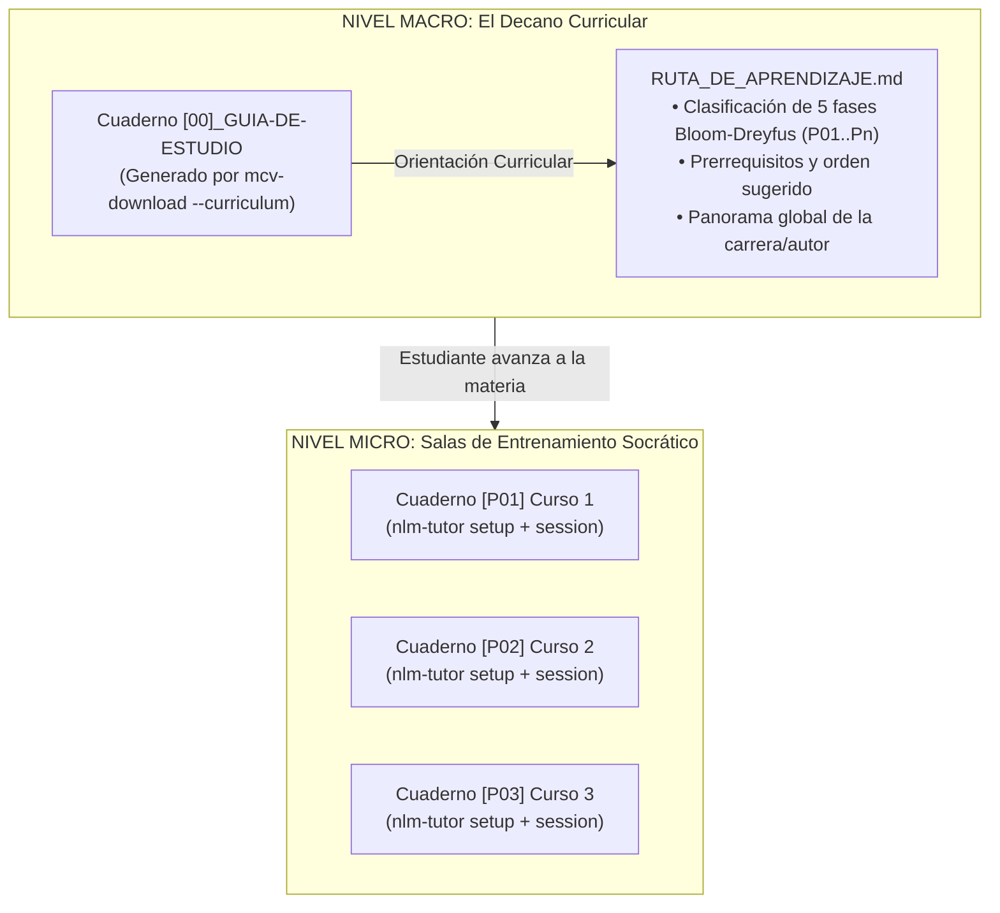

# 🎓 Manual del Estudiante: Domina Cualquier Curso con NotebookLM Pro y NLM-Tutor (v2.0.0)

> **Mentor Socrático Personal, Neurociencia del Aprendizaje Activo (Harvard, MIT, Kaufman, Feynman) y Stack Mínimo Viable (MVLS) con Protección Dinámica de Cuotas en Google NotebookLM Pro.**

Bienvenido a tu sistema de asimilación cerebral acelerada. Este sistema no fue creado para ser una fábrica indiscriminada de resúmenes que jamás vas a leer, sino un **estratega pedagógico personal** diseñado para convertirte en un experto en cada tema con el menor esfuerzo cognitivo y protegiendo al 100% tus cuotas en Google NotebookLM.

---

## 🧠 1. La Ciencia del Aprendizaje: Por qué Menos es Más

La psicología cognitiva y la neurociencia de la educación han demostrado que coleccionar documentos y resaltar textos genera una **ilusión de competencia o fluidez**: el estudiante cree erróneamente que sabe algo porque el material le resulta familiar o lo tiene guardado en carpetas.

Para lograr una verdadera asimilación cerebral a largo plazo, este sistema implementa cuatro pilares rigurosos:

1. **Harvard (*Make It Stick*) & Roediger Testing Effect**:
   - El aprendizaje duradero ocurre durante el **recuerdo activo a libro cerrado** (*Active Recall*), cuando tu cerebro se esfuerza en recuperar un concepto de la memoria en lugar de releerlo pasivamente.
2. **Ritmo Ultradiano del MIT (1972)**:
   - El cerebro humano no puede sostener máxima intensidad por más de 90 minutos. Las sesiones se estructuran en bloques de 15 min de activación, 60 min de esfuerzo socrático profundo y 15 min de meta-aprendizaje y registro de lagunas.
3. **Regla de las 20 Horas de Josh Kaufman**:
   - El 80% de los resultados prácticos de cualquier disciplina proviene del 20% de sus micro-habilidades nucleares. Desarmamos el temario para que domines ese 20% primero y superes la barrera de frustración inicial.
4. **Técnica Feynman & Cuaderno de Lagunas**:
   - No entendés un concepto hasta que podés explicarlo con una analogía simple a un niño de 10 años. Tus errores no se ignoran: se registran en una nota viva (`00_CUADERNO_DE_LAGUNAS`) para dirigir tu atención únicamente hacia tus puntos ciegos.

---

## 🏛️ 2. Arquitectura de Dos Niveles: Decano Curricular vs. Sala de Sparring

Para que tu experiencia sea clara y ordenada, el ecosistema MCV y NotebookLM separa las responsabilidades en dos tipos de cuadernos:



- **El Decano Curricular (`[00]` - Macro)**:
  - Creado automáticamente con `mcv-download --curriculum --upload-nlm`.
  - Contiene la visión holística de todo el catálogo del autor, los prerrequisitos y la secuencia de aprendizaje `[P01]..[Pn]`.
  - **Uso**: Hablá con este cuaderno para entender qué curso tomar primero, cómo se articulan las materias o qué áreas profesionales cubre el autor. No le pidas quizzes de lecciones específicas.
- **La Sala de Entrenamiento Socrático (`[P01]`, `[P02]`... - Micro)**:
  - Creado por `mcv-download` al subir el curso individual.
  - Aquí reside el contenido específico, las transcripciones de audio y los documentos de la materia.
  - **Uso**: Aquí ejecutás `nlm-tutor setup` para habilitar el tutor socrático y `nlm-tutor session` para poner a prueba tu entendimiento activo.

---

## ⚡ 3. Control de Cuotas en Google NotebookLM Pro (Octubre 2026)

Google NotebookLM Pro (Google One AI Premium) opera bajo **dos ventanas de cómputo móviles**:
- **Ventana Móvil (*Rolling Window*)**: ~5 horas.
- **Ventana Semanal (*Weekly Window*)**: 7 días.

### ¿Por qué abandonamos la generación masiva de 11 artefactos de golpe?
Investigaciones recientes de telemetría de cuotas demostraron el consumo relativo de los formatos de Studio:
- **Video Cinemático**: Consume entre **75% y 80%** de la cuota rolling. Dos videos consecutivos provocan bloqueo inmediato por error HTTP 429 (`RESOURCE_EXHAUSTED`).
- **Deep Dive Audio (Podcast)**: Consume entre **12% y 18%** de la cuota rolling.
- **Quizzes, Mapas Mentales, Tablas y Reportes de Texto**: Consumen **<0.5%** (prácticamente cero impacto en la cuota de medios).

Generar 11 a 14 artefactos en un solo instante agotaba la cuota de la cuenta para las siguientes 5 horas y saturaba la mente del estudiante con documentos que nunca abría.

### Consulta tu Cuota en Vivo en la Terminal
Podés verificar la salud exacta de tu cuenta en cualquier momento con:

```bash
nlm-tutor usage
```

Salida típica de telemetría:
```text
============================================================
📊 TELEMETRÍA DE CUOTA GOOGLE NOTEBOOKLM (Octubre 2026)
============================================================
• Nivel de Cuenta: NOTEBOOKLM_TIER_PRO_CONSUMER_USER
• Ventana Móvil (~5h): 97.7% DISPONIBLE (Consumo: 2.3%)
• Ventana Semanal (7d): 98.1% DISPONIBLE (Consumo: 1.9%)
• Estado Operativo: ✅ NORMAL (Capacidad plena para Audio y Texto)
============================================================
```

---

## 📦 4. El Stack Mínimo Viable de Aprendizaje (MVLS - v6.0.0)

A partir de la versión 6.0.0, `nlm-tutor setup` implementa por defecto el **Stack Mínimo Viable (MVLS)**: un paquete quirúrgico de **5 entregables clave estructurados en 4 fases cognitivas**, garantizando máxima asimilación con un consumo inferior al 15% de tu cuota:

| Fase | Entregable | Formato | Propósito Cognitivo |
|---|---|---|---|
| **Fase 1: Exploración Panorámica** | `01_DIAGNOSTICO_Evaluacion-Inicial` | Quiz / Reporte | **Pre-testing**: Intentar responder antes de estudiar prepara las redes neuronales para fijar la información. |
| **Fase 1: Exploración Panorámica** | `02_MAPA_Syllabus-Estructural-80-20` | Mind Map / Guía | **Mapa Mental 80/20**: Ubicación espacial de los nodos centrales sin abrumarse con detalles secundarios. |
| **Fase 2: Inmersión Auditiva** | `03_AUDIO_Inmersion-Podcast` | Deep Dive Audio | **Activación amigable**: 10-15 minutos de diálogo para asimilar ideas mientras salís a caminar o descansás de la pantalla. *(Generado solo si tu cuota móvil supera el 18%)*. |
| **Fase 3: Comprensión 80/20 & Síntesis** | `04_TABLA_Comparativa-80-20` | Tabla de Datos | **Matices y Trade-offs**: Diferenciación clara entre conceptos parecidos para evitar confusiones comunes. |
| **Fase 4: Meta-aprendizaje & Asimilación** | `05_INFORME_Errores-Tipicos-y-Lagunas` | Reporte Ejecutivo | **Catálogo de Errores**: Lista de las 5 trampas más comunes y cómo evitarlas en la práctica. |

Además, `nlm-tutor setup` crea en tu cuaderno dos notas vivas fundamentales:
- `00_CUADERNO_DE_LAGUNAS`: Tu diario personal de conceptos que te costaron trabajo.
- `00_RUTA_DE_ESTUDIO`: La guía paso a paso con los tiempos de estudio y criterios de aprobación.

> [!TIP]
> **¿Querés la batería extendida completa?**
> Si tenés tu cuota al 100% y deseás generar los 11 artefactos tradicionales (quizzes por niveles, flashcards, slides Feynman, etc.), podés solicitarlo explícitamente con:
> ```bash
> nlm-tutor setup "Nombre del Cuaderno" --profile standard
> ```

---

## 🚀 5. Flujo de Trabajo Paso a Paso

### Paso 1: Configurar el Cuaderno
Una vez que subiste tu curso a NotebookLM:
```bash
nlm-tutor setup "Nombre o ID del Cuaderno"
```
El script aplicará automáticamente la directiva socrática al chat, verificará tu cuota en tiempo real y generará los 5 entregables del MVLS con pausas de seguridad (4.5s) para evitar ráfagas de peticiones.

> [!TIP]
> **Blindaje Idempotente Anti-Gasto de Cuota**:
> Si por error volvés a ejecutar `nlm-tutor setup`, el script detecta automáticamente qué artefactos y notas ya existen en tu cuaderno, **omitiendo su creación para no consumir ni un solo byte de tu cuota de Google**. Si querés obligarlo a regenerar todo desde cero, sumá la bandera `--overwrite` o `--clean`:
> ```bash
> nlm-tutor setup "Nombre del Cuaderno" --overwrite
> ```

### Paso 2: Tu Sesión de Concentración Guiada (90 o 45 min)
Iniciá el cronómetro pedagógico en tu terminal:
```bash
nlm-tutor session "Nombre del Cuaderno" --duration 90
```
- **Minuto 0 a 15 (Activación)**: Revisá el Diagnóstico (`01`) y el Mapa Mental (`02`). Escuchá el Audio Podcast (`03`) si preferís desconectar de la pantalla.
- **Minuto 15 a 75 (Esfuerzo Socrático Profundo)**: Entrá al chat y enfrentá las preguntas del tutor. O respondé los cuestionarios directamente en la terminal.
- **Minuto 75 a 90 (Cierre y Registro de Lagunas)**: Anotá en tu nota `00_CUADERNO_DE_LAGUNAS` las preguntas que fallaste o los conceptos que no pudiste explicar claramente.
- **¡Parada Estricta a los 90 min!**: Tomate 20 minutos de descanso total sin pantallas para permitir la consolidación sináptica en reposo.

*(Si tenés poco tiempo hoy, ejecutá `nlm-tutor session "Nombre" --duration 45` para un bloque concentrado de 45 minutos).*

### Paso 3: Cómo Entrenar con el Tutor Socrático
El chat de NotebookLM no es para pedirle: *"Hazme un resumen del tema X"*. Eso produce aprendizaje pasivo e inservible. Usalo con estos patrones de **Interrogación Inversa**:

1. **Para iniciar el sparring**:
   > *"Tutor, ponme a prueba con una pregunta de razonamiento intermedia sobre el primer módulo. No me des la respuesta, espera a que te conteste."*
2. **Para verificar tu comprensión real (Técnica de Interrogación Inversa)**:
   > *"He intentado resolver/explicar esto así: [escribí tu explicación con tus palabras]. Compáralo directamente con el material del cuaderno y dime: 1) ¿Qué omití? 2) ¿En qué fallé técnicamente citando la fuente exacta?"*
3. **Si te sentís bloqueado o frustrado**:
   > *"Explícame este concepto asumiendo que tengo cero experiencia previa y usando una analogía cotidiana, porque me siento bloqueado."*

### Paso 4: Ruta de Asimilación y Calendario de Repaso Espaciado (Ebbinghaus)
Para saber qué estudiar primero y cuándo repasar sin perder tiempo, ejecutá en tu terminal:
```bash
nlm-tutor schedule "Nombre del Cuaderno"
```
El comando te entregará tu hoja de ruta pedagógica en dos fases científicas:
- **Fase 0 (Día de Inicio / Hoy - Estudio Integral)**:
  1. *Inmersión Auditiva (15 min)*: Escuchá `03_AUDIO` (podcast) mientras salís a caminar o preparás tu espacio.
  2. *Cartografía (5 min)*: Mirá el mapa `02_MAPA` para ver la taxonomía y articulación de módulos.
  3. *Deconstrucción 80/20 (20 min)*: Estudiá la tabla `04_TABLA` y el reporte de errores `05_INFORME`.
  4. *Sparring Socrático (45-90 min)*: Resolvé `01_DIAGNOSTICO` a libro cerrado o interactuá con `nlm-tutor session`.
  5. *Registro de Puntos Ciegos (10 min)*: Anotá tus dudas en `00_CUADERNO_DE_LAGUNAS`.
- **Cronograma Matemático Integral (Estudio Activo + Ebbinghaus)**:
  - **Hito 0 (HOY - Inmediato tras leer artefactos)**: Tu sesión socrática interactiva (`nlm-tutor session <ID> --duration 90`) para responder al tutor a libro cerrado y registrar tus lagunas.
  - **Hito 1 (+24h)**: 15 min de auto-explicación Feynman o repaso de `00_CUADERNO_DE_LAGUNAS` sobre los fallos de la sesión de hoy.
  - **Hito 2 (+72h)**: Re-evaluación conceptual con `01_DIAGNOSTICO` a libro cerrado (meta: >80%).
  - **Hito 3 (+7 días)**: 15 min de test de 10 preguntas de razonamiento causal en el chat con `nlm-tutor prompt <ID> 3 --send`.
  - **Hito 4 (+14 días)**: Repaso relámpago exclusivo de tus lagunas en `00_CUADERNO_DE_LAGUNAS`.
  - **Hito 5 (+30 días)**: Síntesis final en voz alta a libro cerrado (`05_INFORME`) para afianzar en memoria permanente.

---

## 🛠️ 6. Referencia de Comandos CLI de `nlm-tutor`

| Comando | Descripción |
|---|---|
| `nlm-tutor usage` | Muestra la telemetría en tiempo real de tu cuota móvil (~5h) y semanal en Google NotebookLM. |
| `nlm-tutor manual` | Despliega este manual del estudiante formateado con colores ANSI directamente en tu terminal. |
| `nlm-tutor list` | Lista todos los cuadernos disponibles en tu cuenta de Google NotebookLM con sus IDs. |
| `nlm-tutor setup <cuaderno>` | Configura el tutor socrático y genera el paquete MVLS (o `--profile standard` para 11 artefactos). |
| `nlm-tutor session <cuaderno>` | Inicia una sesión de estudio guiada con cronómetro pedagógico (`--duration 90` o `45`). |
| `nlm-tutor schedule <cuaderno>` | Calcula el cronograma de repasos espaciados según la curva del olvido de Ebbinghaus. |
| `nlm-tutor prompt <cuaderno> <1-10>` | Muestra o envía (`--send`) uno de los 10 prompts pedagógicos maestros. |
| `nlm-tutor collections` | Inspecciona las colecciones nativas agrupadas en tu cuenta de NotebookLM. |
| `nlm-tutor cross "<pregunta>"` | Realiza una consulta socrática cruzada entre múltiples cursos y autores simultáneamente. |

---

## 💡 7. Biblioteca de los 10 Prompts Pedagógicos Maestros

Podés consultar o disparar cualquiera de estos prompts a tu cuaderno con:
```bash
nlm-tutor prompt "Nombre del Cuaderno" <1-10> --send
```

1. **Prompt 1: Síntesis Estructural 80/20**: Extrae los conceptos que generan el 80% del valor práctico.
2. **Prompt 2: Auto-Enseñanza Feynman**: Explica el concepto central usando analogías del mundo real.
3. **Prompt 3: Batería de Preguntas de Razonamiento**: Cuestionario socrático para medir conexiones conceptuales.
4. **Prompt 4: Plan de Sesión MIT de 90 Minutos**: Secuencia de estudio ultradiana adaptada al cuaderno.
5. **Prompt 5: Catálogo de Errores Típicos & Trampas**: Identifica las 5 confusiones más frecuentes del tema.
6. **Prompt 6: Matices, Debates y Puntos de Desacuerdo**: Contrapone perspectivas dentro del material.
7. **Prompt 7: Mapa Mental en Texto Jerárquico**: Estructura de árbol para visualizar la anatomía del tema.
8. **Prompt 8: Desglose de Micro-Habilidades (Josh Kaufman)**: Secuencia para alcanzar competencia básica en 20 horas.
9. **Prompt 9: Chequeo de Autocorrección y Fuentes**: Verifica si tus conclusiones están fundamentadas en las fuentes.
10. **Prompt 10: Desbloqueo Emocional y Cambio de Perspectiva**: Supera la parálisis cognitiva con un enfoque alternativo.

---

## 🚦 8. Regla de Oro del Avance: El Semáforo

- 🟢 **VERDE (Obtuviste 80% o más en las evaluaciones de razonamiento)**:
  - Dominás las bases nucleares. Estás listo para avanzar al siguiente curso de la ruta (`[P02]`, `[P03]`...).
- 🟡 **AMARILLO / ROJO (Menos del 80%)**:
  - **NO vuelvas a leer todo el curso desde cero**. Eso es una trampa.
  - Abrí tu `00_CUADERNO_DE_LAGUNAS`, identificá exactamente los 2 o 3 conceptos donde fallaste y pedile al tutor en el chat que te interrogue únicamente sobre ellos hasta dominarlos.

¡Buen entrenamiento mental! Con este sistema no acumulás información muerta: construís comprensión viva y permanente.