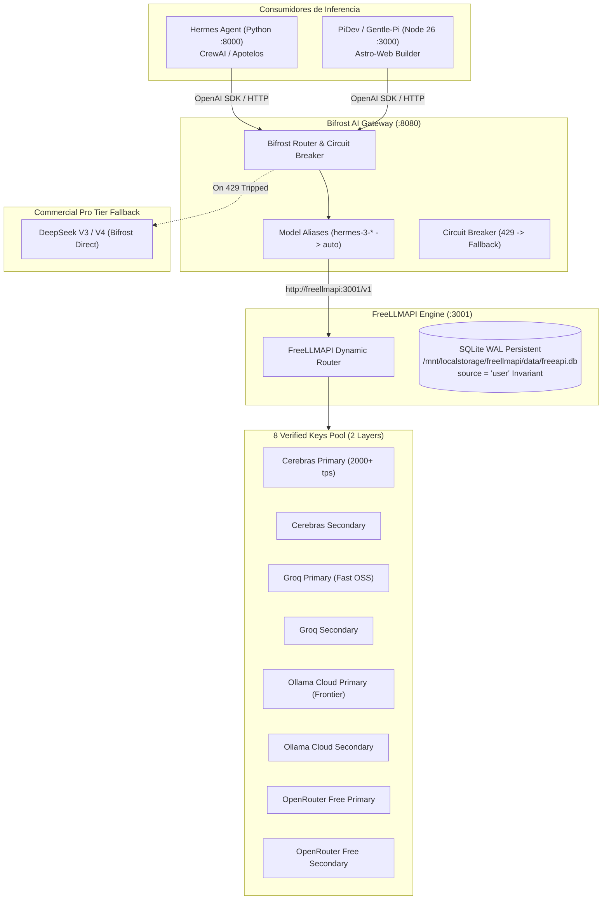

# Template: Sovereign Multi-Provider Free Inference Mesh & Code Builder (v1.0)

Este template documenta la arquitectura SOTA, configuración de persistencia, invariantes físicos y recetas de despliegue para el cluster de inferencia gratuita (FreeLLMAPI + Bifrost) y el agente de desarrollo web soberano (PiDev / Gentle-Pi) en Zerops.

---

## 1. Topología del Ecosistema de Inferencia



---

## 2. Invariantes Críticos de Operación

### Invariante 1: `source = 'user'` en FreeLLMAPI (Anti-Prune)
`catalog-sync.ts` en FreeLLMAPI ejecuta periódicamente:
```sql
DELETE FROM models WHERE source = 'catalog' AND platform_id NOT IN (...remote_ids...);
```
Si los modelos agregados (Cerebras, Ollama, OpenRouter, Qwen) tienen `source = 'catalog'`, el cron los elimina silenciosamente.
**Regla Soberana:** Todo modelo personalizado o provisto por configuración declarativa DEBE registrarse con:
```sql
INSERT INTO models (id, name, platform_id, type, source, is_active, is_free)
VALUES ('qwen-3.8-27b', 'Qwen 2.5 Coder 27B', 'cerebras', 'chat', 'user', 1, 1);
```

### Invariante 2: Routing `$0` Estricto en Bifrost + `freellmapi/auto`
Bifrost OSS reintenta o hace fallback según `routing_rules` y códigos upstream (`429` con backoff entero en ms, `5xx`). `circuit_breaker_config` es **exclusivo Enterprise** (no colocarlo dentro de `governance`).
**Regla Soberana:** En `/mnt/localstorage/bifrost/config.json`, los callers envían `model: "freellmapi/auto"` o `"auto"` y las reglas CEL garantizan:
1. Prioridad 0: `deepseek` solo con `x-force-deepseek: true`, `x-routing-tier: pro`, `x-tier in ['pro','production']` o `model.startsWith('deepseek')`.
2. Prioridad 1: `freellmapi` con fallback a `deepseek` únicamente si `headers['x-allow-paid-fallback'] == 'true'`.
3. Prioridad 2: `true` hacia `freellmapi` con `"fallbacks": []`.

### Invariante 3: Keyless Integrados y Purga de Modelos Guard
- **Keyless integrados (`keyless: true`)**: Registrar `kilo` y `ovh` (`{ "platform": "kilo" }`, `{ "platform": "ovh" }`) sin llave en `FREEAPI_CONFIG_JSON_SECRET` (`vault_env.py`).
- **Modelos Guard / Rotos deshabilitados**: Mantener deshabilitados clasificadores y modelos rotos (`openai/gpt-oss-safeguard-20b`, `allam-2-7b`, `meta-llama/llama-prompt-guard-*`, `ovh/Qwen3Guard-Gen-*`, `nvidia/*guard*`).

### Invariante 4: Permisos de Escritura y Modo Desamordazado de PiDev
- En `pidev/zerops.yaml`:
  ```yaml
  envVariables:
    PI_READ_ONLY: "false"
    PI_OBSERVATIONAL_ONLY: "false"
  ```
- Propiedad de `/home/zerops/.local` debe ser `zerops:zerops` para permitir a npm instalar módulos de usuario.
- Carpeta `/var/www/webdev` debe tener permisos `chmod -R 775` y ownership `zerops:zerops`.

### Invariante 5: Bifrost Governance PostgreSQL SSoT & Single Master VK
Cuando Bifrost tiene `config_store.enabled: true` con PostgreSQL (`config_store.type: "postgres"`):
- Las tablas `governance_virtual_keys`, `config_keys` y `routing_rules` persisten tras el arranque inicial; si modificas `config.json` luego de inicializar la DB, reconcilia `routing_rules` y mantén `aliases_json = NULL` (no `'{}'`) bajo cifrado.
- Usar **una sola Virtual Key respaldada por entorno** (`vk-production-main` con `"value": "env.BIFROST_VIRTUAL_KEY"` desde `${BIFROST_MASTER_VK}`), nunca claves plaintext estáticas (`vk-hermes-agent`, `vk-crewai`, etc.).

### Invariante 6: Aprendizaje Automático de Límites y Límites Groq (`declarative-config.ts`)
- FreeLLMAPI ejecuta `learnLimitFromError()` automáticamente cuando un proveedor upstream reporta límites menores en errores HTTP.
- No inventar límites arbitrarios (ej. `7000`); para `groq/openai/gpt-oss-120b` y `20b` configurar explícitamente `tpmLimit: 8000` y `contextWindow >= 65536` / `sizeLabel` válidos en `FREEAPI_CONFIG_JSON_SECRET`.

### Invariante 8: Progressive Tool Disclosure & Intent Routing en Agentes (Hermes)
Los agentes conversacionales (Hermes Agent) no deben inyectar schemas de 40+ herramientas en turnos de chitchat o consultas conceptuales:
- `HermesAgent.run_turn` clasifica la intención mediante `classify_query_intent`: si la consulta es conversacional/conceptual, despacha con `tools = None`, un prompt magro (~70 tokens) y el header `x-freellm-task-type: chat`.
- Esto reduce el consumo de tokens de ~8,500 a ~50 tokens y la latencia a < 200ms, permitiendo alternancia dinámica entre proveedores libres sin saturar cuotas ni disparar HTTP 413s.
- Las 42 herramientas operativas se reservan estrictamente para consultas que demandan ejecución técnica (`x-freellm-task-type: code`).

### Invariante 9: Estrategia `smartest`, MAB Exploration y OpenRouter Top Priorities
Para evitar el monopolio de un solo proveedor rápido (Cerebras) y aprovechar la flota de OpenRouter y Groq:
- `routing_strategy = 'smartest'` en `settings`: asigna 55% de peso a inteligencia, 35% a confiabilidad y 10% a velocidad.
- `routing_explore_enabled = '1'` en `settings`: activa Thompson Sampling exploration para evitar el *Exploitation Trap* y muestrear periódicamente modelos con pocas observaciones.
- En `profile_models` (Perfil 1), los modelos de OpenRouter de alta capacidad (`dots-studio/dots-3-note-preview:free`, `nvidia/nemotron-3.5-lightning:free`, `openrouter/free`) deben posicionarse en prioridades 1 a 5 junto a Cerebras y Groq.

---

## 3. Matriz de Proveedores Verificados (8 Keys)

| Proveedor | Capa | Clave / Cuenta | Modelos Destacados | Latencia Media |
|---|---|---|---|---|
| **Cerebras Cloud** | Primary | `<CEREBRAS_KEY_1>` | `gpt-oss-120b`, `qwen-3.8-27b`, `llama3.1-8b` | ~112 ms |
| **Cerebras Cloud** | Secondary | `<CEREBRAS_KEY_2>` | `gpt-oss-120b`, `qwen-3.8-27b` | ~115 ms |
| **Groq Cloud** | Primary | `<GROQ_KEY_1>` | `openai/gpt-oss-120b`, `llama-3.3-70b-versatile` | ~150 ms |
| **Groq Cloud** | Secondary | `<GROQ_KEY_2>` | `openai/gpt-oss-120b`, `llama-3.1-8b-instant` | ~148 ms |
| **Ollama Cloud** | Primary | `<OLLAMA_KEY_1>` | `gpt-oss:120b`, `nemotron-3-super`, `gemma4:31b` | ~350 ms |
| **Ollama Cloud** | Secondary | `<OLLAMA_KEY_2>` | `gpt-oss:20b`, `nemotron-3-ultra`, `beam` | ~340 ms |
| **OpenRouter** | Primary | `<OPENROUTER_KEY_1>` | Modelos con sufijo `:free` | ~400 ms |
| **OpenRouter** | Secondary | `<OPENROUTER_KEY_2>` | Modelos con sufijo `:free` | ~390 ms |

---

## 4. Receta de Verificación de Integración (DoD)

```bash
# 1. Probar FreeLLMAPI enrutamiento dinámico 'auto' (usando unified_api_key de SQLite settings)
curl -s http://freellmapi:3001/v1/chat/completions \
  -H "Content-Type: application/json" \
  -H "Authorization: Bearer ${FREELLMAPI_CLIENT_KEY}" \
  -d '{"model":"auto","messages":[{"role":"user","content":"ping"}]}' | jq .choices[0].message.content

# 2. Probar Bifrost con alias transparente de Hermes (hermes-3-* mapeado a auto)
curl -s http://bifrost:8080/v1/chat/completions \
  -H "Content-Type: application/json" \
  -H "Authorization: Bearer bifrost-local" \
  -d '{"model":"auto","messages":[{"role":"user","content":"ping"}]}' | jq .choices[0].message.content

# 3. Probar permisos de escritura de PiDev en /var/www/webdev
ssh pidev "touch /var/www/webdev/.sensor_test && rm /var/www/webdev/.sensor_test && echo 'OK'"
```

---

## 5. Higiene de `deployFiles` y Retención en PostgreSQL

* **`freellmapi` (`zerops.yaml`):** Al finalizar `npm run build -w client && npm run build -w server`, ejecutar `npm prune --omit=dev && rm -rf .git client/src desktop cli tests` para no arrastrar `lucide-react`, `simple-icons`, `typescript` ni fuentes al contenedor `run`.
* **`bifrost` (`db.public.logs`):** En PostgreSQL (`database`), `db.public.logs` promedia ~42 KB por registro y `governance_model_parameters` ~41 MB. Programar purga periódica de logs antiguos en `db.public.logs` para mantener la base bajo 150 MB.
