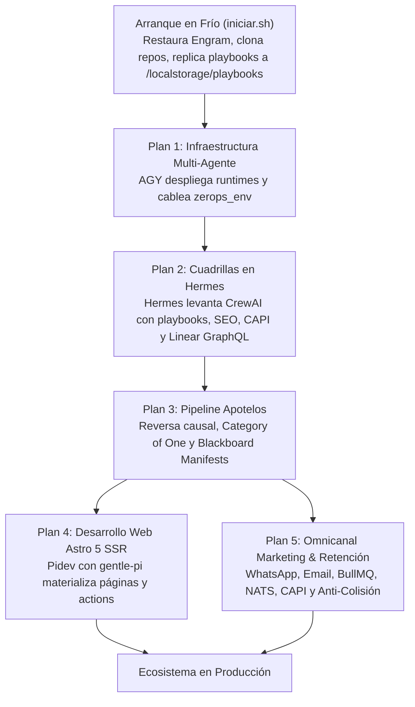

# 🏛️ BLUEPRINT MAESTRO: MALLA MULTI-AGENTE & PIPELINE SOBERANO APOTELOS (v2.1 SOTA)

> **Ubicación Canónica:** `/var/www/artifacts/plans/master_apotelos_multiagent_pipeline.md`  
> **Destino:** Cualquier ZCP nuevo, limpio o existente en Zerops (`${PROJECT_NAME}`).  
> **Gobernanza:** `00-SUPREME-DIRECTIVE.md` (v8.5) · `apotelos` · `meta-plan` · `meta-script` · `codecraft`  
> **Principios:** Cero AMN, Fronteras Estrictas por Runtime, Desacople de Roles, SSoT Indivisible y Soberanía GitOps.

---

## 1. Mapeo Upstream de Plantillas y Herramientas (/var/www)

Para que ningún agente (AGY, Hermes o Pidev) en un ZCP limpio opere a ciegas, la arquitectura se ancla en los siguientes activos upstream inmutables:

### A. Herramientas y Chasis Upstream (`/var/www/zerops-astrobranding`)
- **`iniciar.sh`**: Bootstrapper en frío. Clona repositorios, enlaza binarios en PATH, replica los 19 Playbooks Universales a `/var/www/localstorage/playbooks/` y genera `/var/www/localstorage/hermes/runtime.env`.
- **`scripts/apotelos`**: CLI soberana universal. Gestiona la ontología causal, audita contratos Pydantic v2 y materializa el código mediante `scaffold`.
- **`scripts/linear_bridge.py`**: Bridge tipado universal para Linear. Soporta dual-mode: `linear-cli` en `zcp` y fallback GraphQL nativo (`urllib.request`) en contenedores puros de Python (Hermes, workers).
- **`templates/astro/`**: Componentes canónicos de producción:
  * `SeoHead.astro`: Meta-tags OpenGraph multi-superficie (<300KB WhatsApp budget) y Favicon Suite.
  * `CookieConsent.astro`: Banner de consentimiento y sincronización con Google Consent Mode v2.
  * `contact.ts`: Server Action para captura con validación tipada.
  * `phone.ts`: Normalizador telefónico universal a formato internacional E.164.
  * `discountStrategy.ts`: Cálculo matemático de descuentos con techo de margen protegido.

### B. Plantillas Maestras de Arquitectura (`/var/www/artifacts/templates`)
- **`template-living-marketing-ecosystem.md`**: Topología omnicanal agnóstica, ciclo de vida NATS (`lead.captured`, `cart.abandoned`, `order.created`), colas BullMQ en Valkey 7.2 y políticas anti-colisión.
- **`template-universal-ads-and-telemetry.md`**: Telemetría tri-red (Meta CAPI v21+, Google Ads Enhanced Conversions, TikTok Events API v1.3), Google Consent Mode v2, Transactional Outbox en PostgreSQL 18, drenador reactivo con NATS y guardrails agénticos de presupuesto.
- **`plantilla-universal-web-zerops-v4.md`**: Especificación arquitectónica universal para desarrollo en Astro 5 SSR sobre Bun en Zerops.
- **`template-tri-pillar-multi-agent-mesh.md`**: Arquitectura consolidada de la malla multi-agente (`hermes` + `paperclip` + `crewai`/`pydanticai`), persistencia SSoT y snippets de `zerops.yaml`.

---

## 2. Arquitectura de Fronteras y Desacople de Runtimes

```
┌──────────────────────────────────────────────────────────────────────────────────────┐
│                                 PLANO DE CONTROL (ZCP)                               │
│  - AGY (Antigravity CLI): Supervisión arquitectónica, gobernanza y Linear F4/F5      │
│  - FUSE Google Drive SSoT (/var/www/baiosfera)                                        │
│  - Bootstrapper (iniciar.sh): Clona repos, linkea PATH y replica a /localstorage      │
└──────────────────────────────────────────┬───────────────────────────────────────────┘
                                           │
                    ┌──────────────────────┴──────────────────────┐
                    ▼                                             ▼
┌───────────────────────────────────────┐     ┌────────────────────────────────────────┐
│     RUNTIME PYTHON (hermes :8000)     │     │       RUNTIME WEBDEV (pidev / web)     │
│  - Hermes-Agent Daemon 24/7           │     │  - Pidev Headless Agent (gentle-pi)    │
│  - Cuadrillas CrewAI (OBLIGATORIO)    │     │  - Framework: Astro 5 SSR en Bun 1.3+  │
│    & PydanticAI (complemento rápido)  │     │  - Componentes hidratados (Apotelos)   │
│  - $0 Tokens AGY (Bifrost FreeLLMAPI) │     │  - Componentes hidratados (Apotelos)   │
│  - Playbooks: /mnt/localstorage/      │     │  - Server Actions & Checkout Funnels   │
│  - Skills: seo-aeo-geo, growth-engine │     │  - Skills: astro-web, ad-telemetry,    │
│    sales-enablement, hermes-agent     │     │    checkout-funnels, codecraft         │
└───────────────────┬───────────────────┘     └───────────────────┬────────────────────┘
                    │                                             │
                    └──────────────────────┬──────────────────────┘
                                           │
                                           ▼
┌──────────────────────────────────────────────────────────────────────────────────────┐
│                  ECOSISTEMA OMNICANAL DE RETENCIÓN & CONVERSIÓN                      │
│  - WhatsApp Engine: Evolution Go (:8085) en Alpine/Go + Bot Worker                   │
│  - Email Marketing: Listmonk (:9000) + Throttled BullMQ Worker en Valkey (10/s)      │
│  - Bus Reactivo: NATS JetStream 2.12 (lead.captured, cart.abandoned, order.created) │
│  - Anti-Colisión: Supresión cruzada (WhatsApp activa -> Email mute) + Fencing Valkey │
│  - Skills: whatsapp-engine, email-marketing, automation-engine, payment-gateways     │
└──────────────────────────────────────────────────────────────────────────────────────┘
```

---

## 3. Los 5 Planes Maestros Desacoplados (Secuencia Soberana)

### 🔵 PLAN 1: Infraestructura y Malla Multi-Agente (AGY / Zerops)
- **Ejecutor:** AGY (orquestador de plataforma vía MCP `zerops_*`).
- **Skills Canónicas:** `zcp`, `bifrost`, `freellmapi`, `nats`, `valkey`, `postgresql`, `local-storage`.
- **Plantilla de Referencia:** `/var/www/artifacts/templates/template-tri-pillar-multi-agent-mesh.md`.
- **Alcance:**
  1. Aprovisionamiento desde recetas (`recipes/steps/` o `recipes/services/`):
     - `freellmapi` (Ubuntu Node 24) en `:3001`
     - `bifrost` (Alpine Go 1.22) en `:8080` (config_store y logs_store en PostgreSQL 18)
     - `hermes` (Ubuntu Python 3.12) en `:8000`
     - `pidev` (Ubuntu Node 26) para Gentle-Pi
     - `evolution` (Alpine Go 1.22) en `:8085`
     - Infraestructura compartida: `database` (PostgreSQL 18), `valkey` (7.2), `nats` (2.12), `localstorage` (POSIX NVMe).
  2. Inyección de variables a nivel de proyecto (`zerops_env`):
     - `LINEAR_API_KEY` inyectada a nivel de proyecto para que todos los contenedores la hereden automáticamente en `os.getenv("LINEAR_API_KEY")`.
     - Respaldo en `/mnt/localstorage/hermes/runtime.env` (permisos 600) para redundancia.
     - Registro de Virtual Keys en Bifrost (`vk-hermes-agent`, `vk-crewai`, `vk-pidev`).
- **Sensor Físico de Atestación:**
  - `zerops_verify` exit code 0.
  - Sondas HTTP activas en puertos `:8080`, `:3001`, `:8000`, `:8085`.

---

### 🟣 PLAN 2: Cuadrillas Agénticas CrewAI & PydanticAI (Hermes 24/7)
- **Ejecutor:** Daemon de Hermes dentro del contenedor LXC `hermes` (Ubuntu Python 3.12).
- **Harness Soberano:** Gentle-AI Adapter (`gentle-ai install --agents hermes`), `SOUL.md`, Engram MCP (`/mnt/localstorage/engram`) y PydanticAI Schema Governor con `ModelRetry`.
- **Skills Canónicas:** `hermes-agent`, `growth-engine`, `sales-enablement`, `seo-aeo-geo`, `cohalo`.
- **Playbooks de Referencia:** `/var/www/localstorage/playbooks/` (los 19 playbooks, incluyendo `00_category_of_one_playbook.md`, `copywriting_vanguard_playbook.md`, `lead_conversion_playbook.md`).
- **Alcance:**
  1. Inicialización de Gentle-AI en Hermes (`gentle-ai install --agents hermes`) con conexión a Engram y Context7.
  2. Carga de los 19 Playbooks Universales desde `/mnt/localstorage/playbooks/`.
  3. Integración nativa con Linear mediante `linear_bridge.py` con validación tipada PydanticAI (usando `os.getenv("LINEAR_API_KEY")` o `runtime.env` vía GraphQL directo sin Node).
  4. Ejecución Simétrica de la CLI Apotelos (`/usr/local/bin/apotelos`):
     - Hermes dispone de `/usr/local/bin/apotelos` instalado y symlinkeado nativamente en su contenedor Ubuntu Python 3.12 (`/var/www/scripts/apotelos`).
     - El agente ejecuta `apotelos list`, `apotelos audit`, `apotelos plan`, `apotelos run` y `apotelos dossier` de forma autónoma vía `run_command` sin requerir invocaciones externas.
     - Ingestión directa de contratos ontológicos desde `/mnt/localstorage/${PROJECT_NAME}/dev/verticals/` y playbooks desde `/mnt/localstorage/playbooks/`.
  5. Despliegue de cuadrillas especializadas conectadas al Gateway Bifrost a **$0 tokens de AGY**:
     - **`Copywriting & Velocity Selling Crew` (`growth-engine`)**:
       * Formulación de ofertas irresistibles de Hormozi ($100M Offers) y StoryBrand 2.0.
       * Redacción de ganchos de 3 segundos, desarticulación de objeciones y ángulos psicológicos de venta rápida.
     - **`Commercial Qualification Crew` (`sales-enablement`)**:
       * State machines deterministas bajo marcos BANT, CHAMP y MEDDPICC.
       * Generación de battlecards dinámicas sintetizadas vía Bifrost en $<1.5\text{s}$.
     - **`AEO / GEO / Knowledge Crew` (`seo-aeo-geo`)**:
       * Generación del manifiesto semántico `/llms.txt` y modelado de entidades Schema.org (@graph JSON-LD).
       * Optimización para motores generativos (SearchGPT, Perplexity, Gemini).
     - **`Telemetry & Ad Intelligence Crew` (`ad-telemetry`)**:
       * Contratos de eventos CAPI v21+ y clasificación de presencia de marca (SAB vs Storefront vs Pure Online).
- **Sensor Físico de Atestación:**
  - `curl -s http://hermes:8000/healthz` retornando `{"status":"ok"}`.
  - Test unitario de ejecución de cuadrilla en Hermes sin crasheos ni llamadas redundantes (exit code 0).

---

### 🟢 PLAN 3: Pipeline Causal Apotelos & Generación de Artefactos (AGY + Hermes)
- **Ejecutor:** CLI `apotelos` coordinado por AGY y alimentado por las cuadrillas de Hermes.
- **Skills Canónicas:** `apotelos`, `brandbook`, `meta-gitops`.
- **Plantilla de Referencia:** `/var/www/artifacts/templates/template-universal-ads-and-telemetry.md`.
- **Alcance:**
  1. **Descubrimiento y Gate de Autorización Humana (Ciclo de 3 Etapas)**:
     - *Etapa 1 (Escaneo Profundo)*: Ejecutar `apotelos list <FOLDER>` sobre la carpeta de insumos crudos (`verticales/`). Descubre posibles verticales, monografías y servicios sin mutar el workspace.
     - *Etapa 2 (Gate de Autorización Humana)*: Presentar el descubrimiento al fundador/operador y **solicitar aprobación/curaduría explícita**. Prohibido auto-materializar specs sin el 'Go' humano.
     - *Etapa 3 (Curaduría en `dev/verticals/`)*: Tras la aprobación humana, materializar únicamente los contratos JSON curados (`ecosystem.json`, `<slug>.json`). **Prohibición física**: Nunca copiar `.docx` o `.pdf` crudos a `dev/verticals/`.
  2. Aplicación de la ontología de Reversa Causal ($\tau\epsilon$-Final $\to \tau\epsilon$-0) sobre la marca y sus verticales (`.apotelos/ecosystem.yaml` o `brandbook.json`).
  3. Evaluación estricta de Category of One:
     - **Marcas Personales / Firmas Monopolísticas:** Extracción obligatoria del Mecanismo Único de [`00_category_of_one_playbook.md`](file:///var/www/localstorage/playbooks/00_category_of_one_playbook.md).
     - **E-Commerce / Retail Genérico:** Opcional (deriva a un mecanismo de producto o garantía sin forzar monopolio conceptual).
  4. Compilación de los Blackboard manifests en `/.apotelos/manifests/{brand}_{vertical}.json`.
  5. Mapeo agnóstico de canales de mensajería (TOFU/MOFU/BOFU) según el modelo de negocio (sin presunciones de e-commerce retail).
  6. **Cero código de frontend aún:** El plan concluye con contratos Pydantic v2 cerrados y especificaciones JSON completas listas para Pidev.
- **Sensor Físico de Atestación:**
  - `apotelos audit --vertical=<slug>` validando contratos Pydantic v2 en $<100\text{ms}$ (exit code 0).
  - Archivo físico `.apotelos/manifests/{brand}_{vertical}.json` presente y válido en disco.

---

### 🟡 PLAN 4: Desarrollo Web Astro 5 SSR (Pidev + Gentle-Pi)
- **Ejecutor:** Pidev (runtime dedicado Node 26) usando Gentle-Pi (`pi.dev`).
- **Doctrina Madre:** `codecraft` (TDD, Karpathy guidelines, módulos profundos, verification before completion).
- **Skills Canónicas:** `astro-web`, `gentle-pi`, `codecraft`, `impeccable`, `design-taste-frontend` (`taste-skill`), `ad-telemetry`, `seo-aeo-geo`, `checkout-funnels`, `ghcicd`.
- **Plantillas y Componentes de Referencia:**
  - `/var/www/artifacts/templates/plantilla-universal-web-zerops-v4.md`
  - `/var/www/zerops-astrobranding/templates/astro/` (`SeoHead.astro`, `CookieConsent.astro`, `contact.ts`, `phone.ts`, `discountStrategy.ts`)
- **Alcance:**
  1. Ingesta del Blackboard manifest generado en el Plan 3 y de los artefactos de copy hidratados por `brand-play` (`/mnt/localstorage/${PROJECT_NAME}/dev/workspaces/{brand}/copy/`).
  2. Ejecución headless vía listener HTTP en `:3000` (`pi --approve --provider bifrost --model bifrost/deepseek-chat -p '<prompt>' < /dev/null`) con enrutamiento a Bifrost a $0 tokens.
  3. Ejecución de `apotelos scaffold --vertical=<slug>` para materializar el código Astro 5 SSR:
     - Inyección e hidratación de componentes modulares desde `/var/www/zerops-astrobranding/templates/astro/`:
       * `SeoHead.astro`: Meta-tags OpenGraph multi-surface (<300KB budget) y Favicon Suite (`seo-aeo-geo`).
       * `CookieConsent.astro` + `ConsentModeHead.astro`: Google Consent Mode v2 default denied (`ad-telemetry`).
       * Captura y persistencia de cookie 1st-party `__attr_session` (90 días) con UTMs y Click-IDs (`gclid`, `fbclid`, `ttclid`).
       * `contact.ts`: Server Action con validación Zod y despacho a NATS JetStream.
       * `phone.ts`: Normalizador telefónico universal a formato E.164.
       * `discountStrategy.ts`: Lógica de descuentos protegidos por margen (`growth-engine`).
  4. Ensamble de landing pages, funnels de conversión, pasarelas de pago (Wompi, Bold, COD OTP) y despacho dual CAPI.
  5. Verificación física obligatoria con exit code 0 antes de cualquier pull request o despliegue (`bun run build`).
- **Sensor Físico de Atestación:**
  - `curl -s -X POST http://pidev:3000/execute -d '{"command":"cd /var/www/webdev && bun run build"}'` retornando exit code 0.
  - Validación de tests E2E y linters (`skills-suite-validate`).

---

### 🔴 PLAN 5: Ecosistema Omnicanal de Marketing & Retención (Email, WhatsApp & BullMQ)
- **Ejecutor:** Runtimes dedicados de mensajería (`evolution` Go `:8085` y workers en Bun).
- **Skills Canónicas:** `whatsapp-engine`, `email-marketing`, `automation-engine`, `growth-engine`, `ad-telemetry`.
- **Plantillas de Referencia:**
  - `/var/www/artifacts/templates/template-living-marketing-ecosystem.md`
  - `/var/www/artifacts/templates/template-universal-ads-and-telemetry.md`
- **Alcance:**
  1. Configuración de **Evolution Go** para WhatsApp conversacional:
     - Vinculación QR/Passkey, persistencia de sesión en PostgreSQL (`evogo_auth`), y webhook reactivo a NATS.
     - Bot worker en Bun conectado a Bifrost para atención concierge e inbound bajo la voz del Brandbook.
  2. Configuración de **Listmonk / Email Marketing**:
     - Conexión SMTP/API (ZeptoMail, SES v2, Resend) vía `email_dispatcher.ts`.
     - Throttling con BullMQ en Valkey 7.2 a 10 correos/segundo y cumplimiento RFC 8058 One-Click List-Unsubscribe.
  3. **Telemetry Worker & Transactional Outbox** (`ad-telemetry`):
     - Drenador de eventos en PostgreSQL 18 (`transactional_outbox`) despachando a NATS JetStream con `duplicate_window: 120s`.
     - Dispatcher concurrente a Meta CAPI v21+, Google Ads y TikTok Events API con candado distribuido en Valkey.
  4. Orquestación de Flujos de Ciclo de Vida TOFU / MOFU / BOFU:
     - Disparadores por eventos NATS (`lead.captured`, `cart.abandoned`, `order.created`).
     - **Protocolo Anti-Colisión**: Supresión cruzada (WhatsApp activa silencia email promocional) y Fencing Tokens de versionado monotónico en Valkey (`HINCRBY stage_version`) para auto-descartar recordatorios obsoletos.
- **Sensor Físico de Atestación:**
  - `curl -s http://evolution:8085` retornando respuesta válida.
  - Test de publicación y consumo en NATS (`nats pub commerce.signals.lead '{"test":true}'`).
  - Verificación de cerradura de cooldown en Valkey (`EXISTS lock:contact:cooldown:{phone}`).

---

## 4. Resumen de Flujo para un AGY Nuevo en ZCP Limpio


